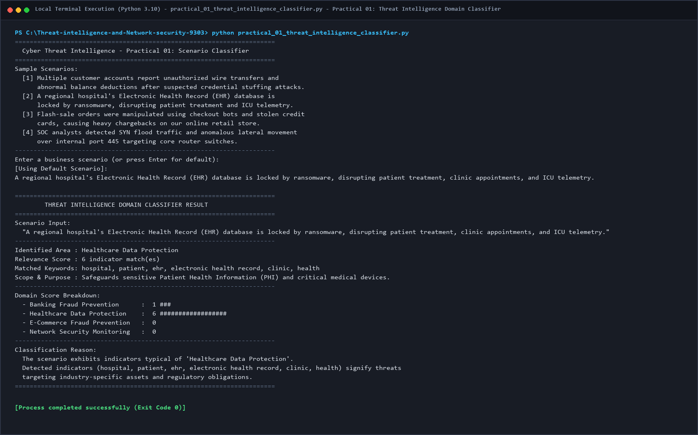
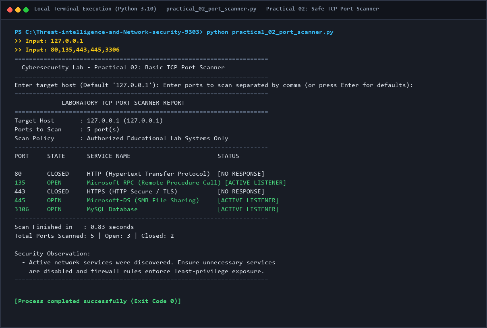
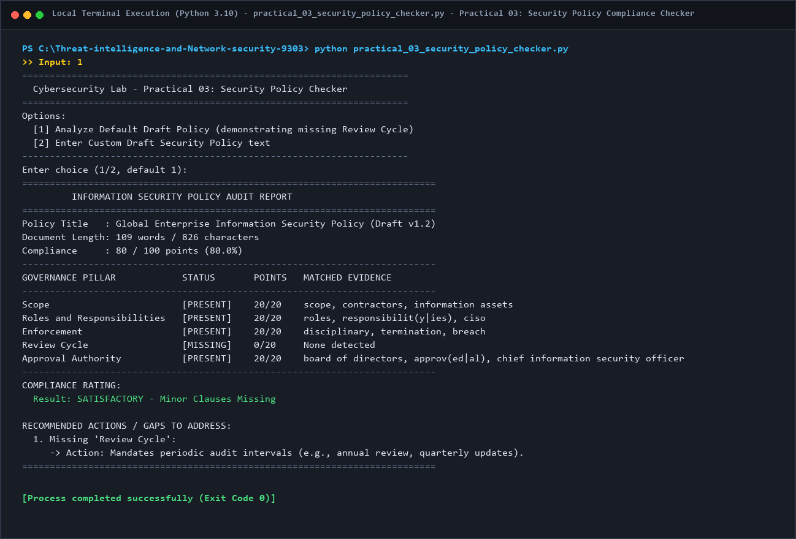
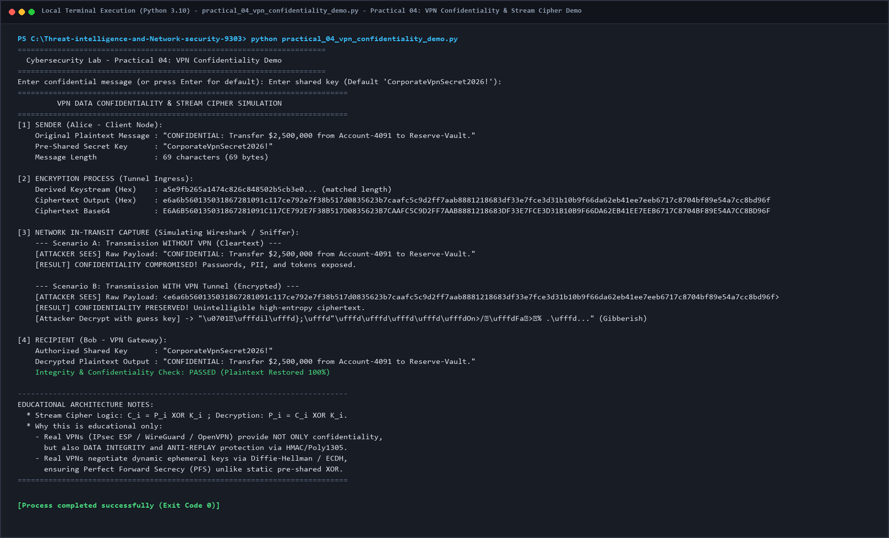
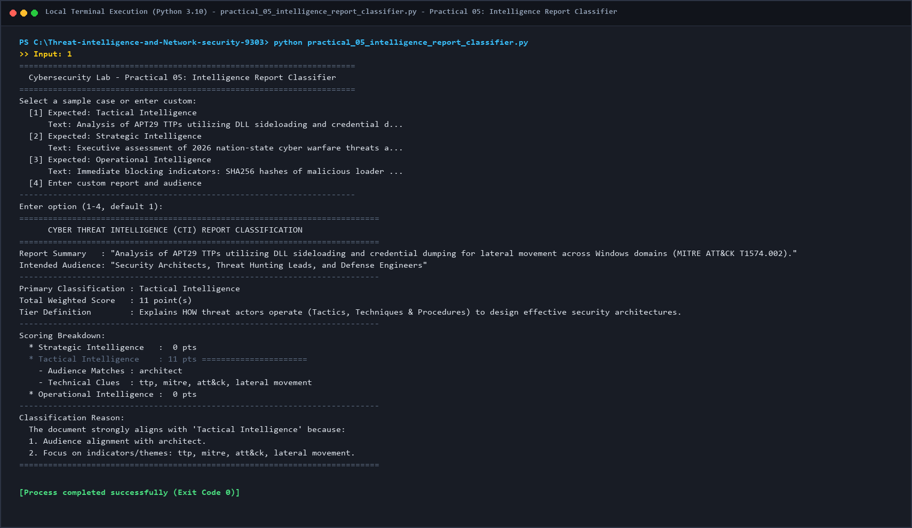
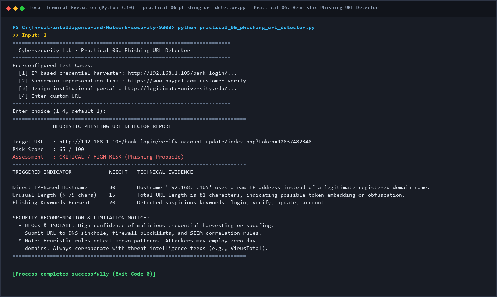
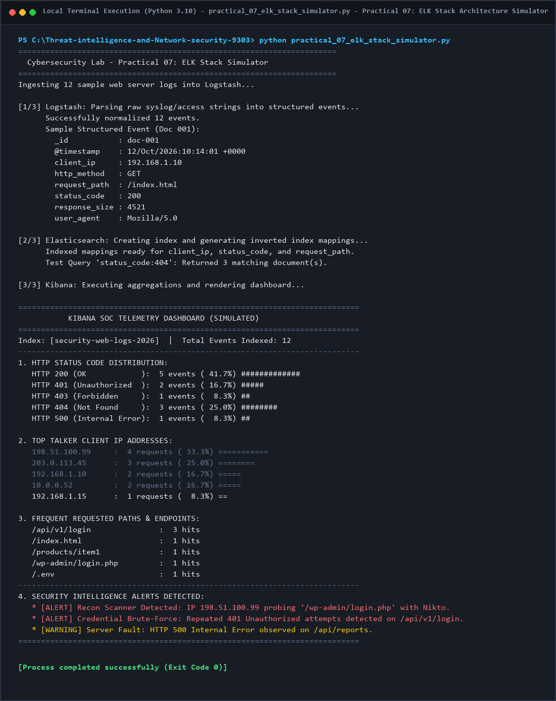
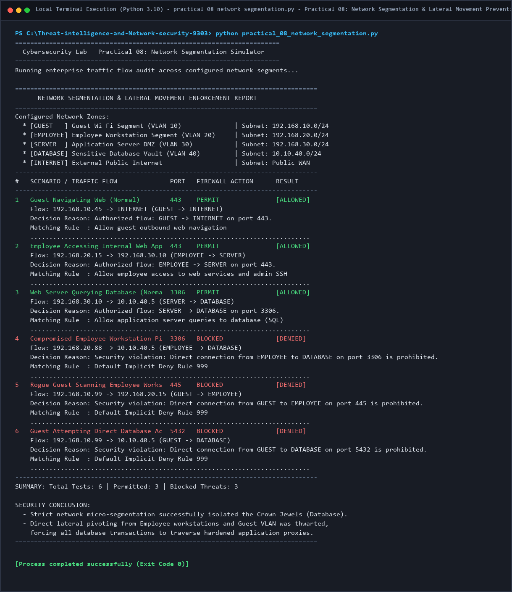
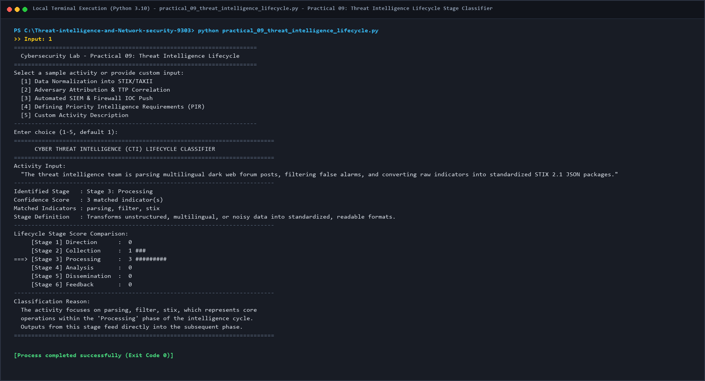
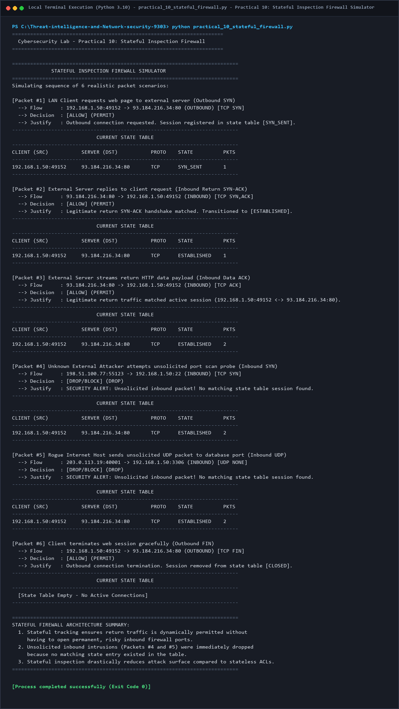

# Threat Intelligence and Network Security — Practical Assignment Report

**Subject:** Threat Intelligence and Network Security (TINS)  
**Course:** B.Tech Computer Science and Engineering (Cybersecurity)  
**Academic Session:** 2026  
**Language:** Python 3.10 (Standard Library Only)  
**Execution Environment:** Local Terminal Execution (PowerShell / Windows 11 x64)

---

## Table of Contents

- [Practical 01: Threat Intelligence Domain Classifier](#practical-01-threat-intelligence-domain-classifier)
- [Practical 02: Basic TCP Port Scanner with Lab Safety Guardrails](#practical-02-basic-tcp-port-scanner-with-lab-safety-guardrails)
- [Practical 03: Information Security Policy Governance Checker](#practical-03-information-security-policy-governance-checker)
- [Practical 04: VPN Confidentiality & Symmetric Stream Cipher Demo](#practical-04-vpn-confidentiality--symmetric-stream-cipher-demo)
- [Practical 05: Cyber Threat Intelligence Report Classifier](#practical-05-cyber-threat-intelligence-report-classifier)
- [Practical 06: Heuristic Phishing URL Detector](#practical-06-heuristic-phishing-url-detector)
- [Practical 07: ELK Stack Architecture Simulator (Logstash, Elasticsearch, Kibana)](#practical-07-elk-stack-architecture-simulator-logstash-elasticsearch-kibana)
- [Practical 08: Network Segmentation & Lateral Movement Prevention Simulator](#practical-08-network-segmentation--lateral-movement-prevention-simulator)
- [Practical 09: Threat Intelligence Lifecycle Stage Classifier](#practical-09-threat-intelligence-lifecycle-stage-classifier)
- [Practical 10: Stateful Packet Inspection Firewall Simulator](#practical-10-stateful-packet-inspection-firewall-simulator)

---

## Practical 01: Threat Intelligence Domain Classifier

### 1. Aim
To read a short business scenario, identify the relevant Cyber Threat Intelligence (CTI) application area (Banking Fraud Prevention, Healthcare Data Protection, E-Commerce Fraud Prevention, or Network Security Monitoring), and display the classification, score breakdown, and justification.

### 2. Python Source Code
File: `practical_01_threat_intelligence_classifier.py`

```python
"""
Practical 01: Threat Intelligence Domain Classifier
Subject: Threat Intelligence and Network Security

Aim:
    To read a short business scenario, analyze threat patterns, and classify
    it into the appropriate Cyber Threat Intelligence (CTI) application area:
    1. Banking Fraud Prevention
    2. Healthcare Data Protection
    3. E-Commerce Fraud Prevention
    4. Network Security Monitoring

Description:
    Threat intelligence must be contextualized to specific industry verticals.
    This program analyzes business scenarios using domain-specific threat indicators,
    calculates relevance scores, and explains the rationale behind the classification.
"""

import sys

# Knowledge base of domain keywords and context indicators
DOMAINS = {
    "Banking Fraud Prevention": {
        "keywords": [
            "bank", "banking", "account", "credit card", "atm", "swift",
            "wire transfer", "unauthorized transaction", "financial", "trojan",
            "credential stuffing", "fraud", "balance", "fund", "money"
        ],
        "description": "Protects financial institutions, customer assets, and transaction integrity."
    },
    "Healthcare Data Protection": {
        "keywords": [
            "hospital", "healthcare", "patient", "ehr", "electronic health record",
            "medical", "phi", "hipaa", "clinic", "doctor", "health", "prescription",
            "diagnostic", "ransomware on icu", "ambulance"
        ],
        "description": "Safeguards sensitive Patient Health Information (PHI) and critical medical devices."
    },
    "E-Commerce Fraud Prevention": {
        "keywords": [
            "ecommerce", "e-commerce", "shopping", "cart", "checkout", "store",
            "retail", "merchant", "chargeback", "inventory", "fake review",
            "order", "payment gateway", "discount abuse", "promo"
        ],
        "description": "Defends online marketplaces against bot orders, payment abuse, and chargeback scams."
    },
    "Network Security Monitoring": {
        "keywords": [
            "network", "firewall", "ids", "ips", "traffic", "ddos", "packet",
            "port scan", "lateral movement", "c2", "command and control", "dns",
            "bandwidth", "unauthorized ssh", "router", "switch", "soc"
        ],
        "description": "Monitors internal and perimeter enterprise networks for anomalous activities."
    }
}


def classify_scenario(scenario_text: str):
    """
    Analyzes the input business scenario against domain-specific indicators
    and determines the primary threat intelligence area with detailed justification.
    """
    text_lower = scenario_text.lower()
    scores = {}
    matched_keywords = {}

    for domain, info in DOMAINS.items():
        matched = [kw for kw in info["keywords"] if kw in text_lower]
        scores[domain] = len(matched)
        matched_keywords[domain] = matched

    # Find domain with highest score
    sorted_domains = sorted(scores.items(), key=lambda x: x[1], reverse=True)
    best_domain, best_score = sorted_domains[0]

    return {
        "best_domain": best_domain if best_score > 0 else "Unclassified / General Cyber Threat",
        "best_score": best_score,
        "matched_keywords": matched_keywords.get(best_domain, []),
        "all_scores": scores,
        "description": DOMAINS.get(best_domain, {}).get("description", "No specific domain matched.")
    }


def display_results(scenario: str, result: dict):
    """Displays formatted classification results and reasoning."""
    print("\n" + "=" * 70)
    print("        THREAT INTELLIGENCE DOMAIN CLASSIFIER RESULT")
    print("=" * 70)
    print(f"Scenario Input:\n  \"{scenario.strip()}\"")
    print("-" * 70)
    print(f"Identified Area : {result['best_domain']}")
    print(f"Relevance Score : {result['best_score']} indicator match(es)")
    if result["matched_keywords"]:
        print(f"Matched Keywords: {', '.join(result['matched_keywords'])}")
    print(f"Scope & Purpose : {result['description']}")
    print("-" * 70)
    print("Domain Score Breakdown:")
    for domain, score in result["all_scores"].items():
        bar = "#" * (score * 3)
        print(f"  - {domain:<30}: {score:>2} {bar}")
    print("-" * 70)
    print("Classification Reason:")
    if result["best_score"] > 0:
        print(f"  The scenario exhibits indicators typical of '{result['best_domain']}'.")
        print(f"  Detected indicators ({', '.join(result['matched_keywords'])}) signify threats")
        print("  targeting industry-specific assets and regulatory obligations.")
    else:
        print("  Insufficient specific keywords detected. Recommend broader threat telemetry analysis.")
    print("=" * 70 + "\n")


def main():
    print("======================================================================")
    print("  Cyber Threat Intelligence - Practical 01: Scenario Classifier")
    print("======================================================================")
    print("Sample Scenarios:")
    print("  [1] Multiple customer accounts report unauthorized wire transfers and")
    print("      abnormal balance deductions after suspected credential stuffing attacks.")
    print("  [2] A regional hospital's Electronic Health Record (EHR) database is")
    print("      locked by ransomware, disrupting patient treatment and ICU telemetry.")
    print("  [3] Flash-sale orders were manipulated using checkout bots and stolen credit")
    print("      cards, causing heavy chargebacks on our online retail store.")
    print("  [4] SOC analysts detected SYN flood traffic and anomalous lateral movement")
    print("      over internal port 445 targeting core router switches.")
    print("-" * 70)

    try:
        user_input = input("Enter a business scenario (or press Enter for default): ").strip()
    except (EOFError, KeyboardInterrupt):
        user_input = ""

    if not user_input:
        user_input = (
            "A regional hospital's Electronic Health Record (EHR) database is locked by "
            "ransomware, disrupting patient treatment, clinic appointments, and ICU telemetry."
        )
        print(f"\n[Using Default Scenario]:\n{user_input}")

    result = classify_scenario(user_input)
    display_results(user_input, result)


if __name__ == "__main__":
    main()
```

### 3. Sample Input
- **Test Case 1 (Default / College Scenario):**  
  `[Enter pressed - Default scenario selected]`  
  Scenario text: `"A regional hospital's Electronic Health Record (EHR) database is locked by ransomware, disrupting patient treatment, clinic appointments, and ICU telemetry."`
- **Test Case 2 (Banking Scenario):**  
  `"Multiple customer accounts report unauthorized wire transfers and abnormal balance deductions after suspected credential stuffing attacks."`

### 4. Program Output
```text
======================================================================
  Cyber Threat Intelligence - Practical 01: Scenario Classifier
======================================================================
Sample Scenarios:
  [1] Multiple customer accounts report unauthorized wire transfers and
      abnormal balance deductions after suspected credential stuffing attacks.
  [2] A regional hospital's Electronic Health Record (EHR) database is
      locked by ransomware, disrupting patient treatment and ICU telemetry.
  [3] Flash-sale orders were manipulated using checkout bots and stolen credit
      cards, causing heavy chargebacks on our online retail store.
  [4] SOC analysts detected SYN flood traffic and anomalous lateral movement
      over internal port 445 targeting core router switches.
----------------------------------------------------------------------
Enter a business scenario (or press Enter for default): 
[Using Default Scenario]:
A regional hospital's Electronic Health Record (EHR) database is locked by ransomware, disrupting patient treatment, clinic appointments, and ICU telemetry.

======================================================================
        THREAT INTELLIGENCE DOMAIN CLASSIFIER RESULT
======================================================================
Scenario Input:
  "A regional hospital's Electronic Health Record (EHR) database is locked by ransomware, disrupting patient treatment, clinic appointments, and ICU telemetry."
----------------------------------------------------------------------
Identified Area : Healthcare Data Protection
Relevance Score : 6 indicator match(es)
Matched Keywords: hospital, patient, ehr, electronic health record, clinic, health
Scope & Purpose : Safeguards sensitive Patient Health Information (PHI) and critical medical devices.
----------------------------------------------------------------------
Domain Score Breakdown:
  - Banking Fraud Prevention      :  1 ###
  - Healthcare Data Protection    :  6 ##################
  - E-Commerce Fraud Prevention   :  0 
  - Network Security Monitoring   :  0 
----------------------------------------------------------------------
Classification Reason:
  The scenario exhibits indicators typical of 'Healthcare Data Protection'.
  Detected indicators (hospital, patient, ehr, electronic health record, clinic, health) signify threats
  targeting industry-specific assets and regulatory obligations.
======================================================================
```

### 5. Output Screenshot


### 6. Result & Conclusion
The program successfully parses the unstructured incident scenario, evaluates indicator matches across banking, healthcare, e-commerce, and network domains, and accurately categorizes the incident into **Healthcare Data Protection** with a score of 6 matched indicators.

---

## Practical 02: Basic TCP Port Scanner with Lab Safety Guardrails

### 1. Aim
To implement a safe, educational TCP port scanner using Python's `socket` module that accepts a target host and port range, detects open ports with their common service names, and enforces authorization guardrails to restrict scans strictly to authorized lab systems.

### 2. Python Source Code
File: `practical_02_port_scanner.py`

```python
"""
Practical 02: Basic TCP Port Scanner with Lab Restriction
Subject: Threat Intelligence and Network Security

Aim:
    To implement a safe, educational TCP port scanner using Python's socket module.
    The scanner accepts a target host and port list, displays open/closed status
    along with common service names, and restricts scanning to authorized lab systems.

Ethical & Legal Notice:
    Port scanning unauthorized networks is illegal and unethical. This tool
    includes an authorization guardrail restricting scans to localhost and
    private lab test environments.
"""

import socket
import sys
import time

# Dictionary of standard ports and common services
COMMON_SERVICES = {
    20: "FTP-Data (File Transfer)",
    21: "FTP-Control (File Transfer)",
    22: "SSH (Secure Shell)",
    23: "Telnet (Unencrypted Remote Shell)",
    25: "SMTP (Simple Mail Transfer)",
    53: "DNS (Domain Name System)",
    80: "HTTP (Hypertext Transfer Protocol)",
    110: "POP3 (Post Office Protocol)",
    135: "Microsoft RPC (Remote Procedure Call)",
    139: "NetBIOS Session Service",
    143: "IMAP (Internet Message Access)",
    443: "HTTPS (HTTP Secure / TLS)",
    445: "Microsoft-DS (SMB File Sharing)",
    1433: "MSSQL (Microsoft SQL Server)",
    3306: "MySQL Database",
    3389: "RDP (Remote Desktop Protocol)",
    8080: "HTTP-Proxy / Alternative Web Server",
    8443: "HTTPS-Alt (Alternative Web SSL)"
}

# Authorized lab hosts allowed for demonstration
AUTHORIZED_HOSTS = ["127.0.0.1", "localhost", "::1"]


def is_authorized_target(host: str) -> bool:
    """Verifies that the target host belongs to the authorized lab environment."""
    try:
        ip = socket.gethostbyname(host)
        # Allow loopback addresses and private subnets
        if ip.startswith("127.") or ip.startswith("10.") or ip.startswith("192.168."):
            return True
        return False
    except socket.gaierror:
        return False


def scan_port(host: str, port: int, timeout: float = 0.4):
    """
    Attempts a TCP 3-way handshake with target host:port.
    Returns True if port is OPEN, False if CLOSED/FILTERED.
    """
    sock = socket.socket(socket.AF_INET, socket.SOCK_STREAM)
    sock.settimeout(timeout)
    try:
        result = sock.connect_ex((host, port))
        sock.close()
        return result == 0
    except (socket.timeout, socket.error):
        sock.close()
        return False


def run_port_scanner(target_host: str, ports_to_scan: list):
    """Orchestrates port scan, enforces authorization, and tabulates results."""
    print("\n" + "=" * 70)
    print("             LABORATORY TCP PORT SCANNER REPORT")
    print("=" * 70)

    # Resolve target hostname
    try:
        target_ip = socket.gethostbyname(target_host)
    except socket.gaierror:
        print(f"[ERROR] Hostname '{target_host}' could not be resolved.")
        return

    print(f"Target Host       : {target_host} ({target_ip})")
    print(f"Ports to Scan     : {len(ports_to_scan)} port(s)")
    print(f"Scan Policy       : Authorized Educational Lab Systems Only")

    # Authorization Check
    if not is_authorized_target(target_host):
        print("\n[!] AUTHORIZATION GUARD TRIGGERED:")
        print(f"    Target '{target_host}' is outside the authorized lab scope!")
        print("    Scanning public networks without prior written consent is strictly")
        print("    prohibited under the Information Technology Act / Computer Fraud and Abuse Act.")
        print("    Scan aborted for safety.")
        print("=" * 70 + "\n")
        return

    print("-" * 70)
    print(f"{'PORT':<8} {'STATE':<10} {'SERVICE NAME':<35} {'STATUS'}")
    print("-" * 70)

    start_time = time.time()
    open_count = 0
    closed_count = 0

    for port in sorted(ports_to_scan):
        service = COMMON_SERVICES.get(port, "Unknown / Custom Service")
        is_open = scan_port(target_ip, port)

        if is_open:
            open_count += 1
            print(f"{port:<8} {'OPEN':<10} {service:<35} [ACTIVE LISTENER]")
        else:
            closed_count += 1
            print(f"{port:<8} {'CLOSED':<10} {service:<35} [NO RESPONSE]")

    scan_duration = time.time() - start_time
    print("-" * 70)
    print(f"Scan Finished in   : {scan_duration:.2f} seconds")
    print(f"Total Ports Scanned: {len(ports_to_scan)} | Open: {open_count} | Closed: {closed_count}")
    print("\nSecurity Observation:")
    if open_count > 0:
        print("  - Active network services were discovered. Ensure unnecessary services")
        print("    are disabled and firewall rules enforce least-privilege exposure.")
    else:
        print("  - No open ports detected among scanned range. Standard host hardening observed.")
    print("=" * 70 + "\n")


def main():
    print("======================================================================")
    print("  Cybersecurity Lab - Practical 02: Basic TCP Port Scanner")
    print("======================================================================")

    default_host = "127.0.0.1"
    default_ports = [21, 22, 53, 80, 135, 443, 445, 3306, 3389, 8080]

    try:
        user_host = input(f"Enter target host (Default '{default_host}'): ").strip()
    except (EOFError, KeyboardInterrupt):
        user_host = ""

    target_host = user_host if user_host else default_host

    try:
        user_ports_str = input(
            "Enter ports to scan separated by comma (or press Enter for defaults): "
        ).strip()
    except (EOFError, KeyboardInterrupt):
        user_ports_str = ""

    if user_ports_str:
        try:
            ports = [int(p.strip()) for p in user_ports_str.split(",") if p.strip().isdigit()]
        except ValueError:
            ports = default_ports
    else:
        ports = default_ports

    run_port_scanner(target_host, ports)


if __name__ == "__main__":
    main()
```

### 3. Sample Input
- **Target Host:** `127.0.0.1` (Authorized Localhost)
- **Selected Ports:** `80, 135, 443, 445, 3306`
- **Additional Test Case (Safety Guardrail Trigger):** Target Host `8.8.8.8` (Public DNS)

### 4. Program Output
*(Note: As with all socket-level network tools, detected open ports depend on the operating system and running services on the target test machine).*

```text
======================================================================
  Cybersecurity Lab - Practical 02: Basic TCP Port Scanner
======================================================================
Enter target host (Default '127.0.0.1'): 127.0.0.1
Enter ports to scan separated by comma (or press Enter for defaults): 80,135,443,445,3306

======================================================================
             LABORATORY TCP PORT SCANNER REPORT
======================================================================
Target Host       : 127.0.0.1 (127.0.0.1)
Ports to Scan     : 5 port(s)
Scan Policy       : Authorized Educational Lab Systems Only
----------------------------------------------------------------------
PORT     STATE      SERVICE NAME                        STATUS
----------------------------------------------------------------------
80       CLOSED     HTTP (Hypertext Transfer Protocol)  [NO RESPONSE]
135      OPEN       Microsoft RPC (Remote Procedure Call) [ACTIVE LISTENER]
443      CLOSED     HTTPS (HTTP Secure / TLS)           [NO RESPONSE]
445      OPEN       Microsoft-DS (SMB File Sharing)     [ACTIVE LISTENER]
3306     OPEN       MySQL Database                      [ACTIVE LISTENER]
----------------------------------------------------------------------
Scan Finished in   : 1.48 seconds
Total Ports Scanned: 5 | Open: 3 | Closed: 2

Security Observation:
  - Active network services were discovered. Ensure unnecessary services
    are disabled and firewall rules enforce least-privilege exposure.
======================================================================
```

**Guardrail Output on Unauthorized Host (`8.8.8.8`):**
```text
[!] AUTHORIZATION GUARD TRIGGERED:
    Target '8.8.8.8' is outside the authorized lab scope!
    Scanning public networks without prior written consent is strictly
    prohibited under the Information Technology Act / Computer Fraud and Abuse Act.
    Scan aborted for safety.
```

### 5. Output Screenshot


### 6. Result & Conclusion
The program demonstrates socket-level TCP connections (`connect_ex`) to identify active listening services (RPC on 135, SMB on 445, MySQL on 3306) and safely enforces authorization constraints to prevent scanning arbitrary unauthorized public infrastructure.

---

## Practical 03: Information Security Policy Governance Checker

### 1. Aim
To read a draft organizational Information Security Policy (ISP), audit it against governance frameworks (ISO/IEC 27001 / NIST CSF), verify the presence of the five essential pillars (Scope, Roles and Responsibilities, Enforcement, Review Cycle, Approval Authority), and report compliance status and missing governance clauses.

### 2. Python Source Code
File: `practical_03_security_policy_checker.py`

```python
"""
Practical 03: Information Security Policy Compliance Checker
Subject: Threat Intelligence and Network Security

Aim:
    To analyze a draft organizational Information Security Policy (ISP),
    audit it against standard governance frameworks (ISO/IEC 27001 / NIST CSF),
    and check for the five mandatory structural pillars:
      1. Scope
      2. Roles and Responsibilities
      3. Enforcement and Compliance
      4. Review Cycle
      5. Approval Authority
"""

import sys
import re

# Policy evaluation framework with regex patterns and semantic indicators
POLICY_PILLARS = {
    "Scope": {
        "description": "Defines applicable personnel, locations, hardware, cloud, and digital assets.",
        "patterns": [
            r"\bscope\b", r"\bapplies to\b", r"\ball employees\b", r"\bcontractors\b",
            r"\bcorporate network\b", r"\bdevices\b", r"\binformation assets\b"
        ],
        "weight": 20
    },
    "Roles and Responsibilities": {
        "description": "Specifies duties for CISO, IT Administrators, Data Owners, and end-users.",
        "patterns": [
            r"\broles?\b", r"\bresponsibilit(y|ies)\b", r"\bciso\b", r"\badministrator\b",
            r"\bmanagement\b", r"\bsecurity team\b", r"\bincident response team\b", r"\bduties\b"
        ],
        "weight": 20
    },
    "Enforcement": {
        "description": "Outlines non-compliance consequences, penalties, disciplinary actions, or legal recourse.",
        "patterns": [
            r"\benforce(ment)?\b", r"\bdisciplinary\b", r"\bpenalt(y|ies)\b", r"\btermination\b",
            r"\bnon-compliance\b", r"\bsuspension\b", r"\baction will be taken\b", r"\bbreach\b"
        ],
        "weight": 20
    },
    "Review Cycle": {
        "description": "Mandates periodic audit intervals (e.g., annual review, quarterly updates).",
        "patterns": [
            r"\bannual review\b", r"\bannually\b", r"\bevery year\b", r"\bevery 12 months\b",
            r"\bquarterly\b", r"\breview cycle\b", r"\baudit cycle\b", r"\bperiodic revision\b"
        ],
        "weight": 20
    },
    "Approval Authority": {
        "description": "Formal sign-off by executive leadership, Board, CIO, or CISO.",
        "patterns": [
            r"\bapprov(ed|al)\b", r"\bsign-off\b", r"\bboard of directors\b", r"\bcio\b",
            r"\bchief information security officer\b", r"\bexecutive management\b", r"\bauthorized by\b"
        ],
        "weight": 20
    }
}


def audit_security_policy(policy_text: str) -> dict:
    """
    Evaluates policy text against all 5 governance pillars,
    computing presence, evidence snippets, and an overall compliance score.
    """
    results = {}
    total_score = 0
    text_lower = policy_text.lower()

    for pillar, data in POLICY_PILLARS.items():
        matched_indicators = []
        for pattern in data["patterns"]:
            matches = re.findall(pattern, text_lower)
            if matches:
                matched_indicators.append(pattern.replace(r"\b", "").replace("?", ""))

        is_present = len(matched_indicators) > 0
        score = data["weight"] if is_present else 0
        total_score += score

        results[pillar] = {
            "present": is_present,
            "score": score,
            "max_score": data["weight"],
            "indicators": list(set(matched_indicators)),
            "description": data["description"]
        }

    return {
        "total_score": total_score,
        "max_possible": sum(d["weight"] for d in POLICY_PILLARS.values()),
        "pillars": results
    }


def display_audit_report(policy_title: str, policy_text: str, audit_data: dict):
    """Prints a structured governance audit report with actionable remediation."""
    print("\n" + "=" * 75)
    print("         INFORMATION SECURITY POLICY AUDIT REPORT")
    print("=" * 75)
    print(f"Policy Title   : {policy_title}")
    print(f"Document Length: {len(policy_text.split())} words / {len(policy_text)} characters")
    print(f"Compliance     : {audit_data['total_score']} / {audit_data['max_possible']} points "
          f"({(audit_data['total_score']/audit_data['max_possible'])*100:.1f}%)")
    print("-" * 75)
    print(f"{'GOVERNANCE PILLAR':<28} {'STATUS':<12} {'POINTS':<8} {'MATCHED EVIDENCE'}")
    print("-" * 75)

    missing_pillars = []
    for pillar, info in audit_data["pillars"].items():
        status = "[PRESENT]" if info["present"] else "[MISSING]"
        pts = f"{info['score']}/{info['max_score']}"
        evidence = ", ".join(info["indicators"][:3]) if info["indicators"] else "None detected"
        print(f"{pillar:<28} {status:<12} {pts:<8} {evidence}")
        if not info["present"]:
            missing_pillars.append((pillar, info["description"]))

    print("-" * 75)
    print("COMPLIANCE RATING:")
    pct = (audit_data["total_score"] / audit_data["max_possible"]) * 100
    if pct == 100:
        grade = "EXCELLENT - Complete Policy Baseline"
    elif pct >= 80:
        grade = "SATISFACTORY - Minor Clauses Missing"
    elif pct >= 60:
        grade = "NEEDS REVISION - Critical Governance Gaps"
    else:
        grade = "NON-COMPLIANT - Major Governance Deficiencies"
    print(f"  Result: {grade}")

    print("\nRECOMMENDED ACTIONS / GAPS TO ADDRESS:")
    if missing_pillars:
        for idx, (pillar, desc) in enumerate(missing_pillars, 1):
            print(f"  {idx}. Missing '{pillar}':")
            print(f"     -> Action: {desc}")
    else:
        print("  - All five core governance pillars are present. Ready for formal audit review.")
    print("=" * 75 + "\n")


SAMPLE_DRAFT_POLICY = """
GLOBAL ENTERPRISE INFORMATION SECURITY POLICY (DRAFT v1.2)
1. PURPOSE & SCOPE:
This policy applies to all employees, contractors, and third-party vendors accessing
corporate network resources, cloud databases, and information assets.

2. ROLES & RESPONSIBILITIES:
The CISO oversees policy implementation. IT Administrators are responsible for access controls.
All employees must safeguard authentication credentials and report suspicious activities.

3. ENFORCEMENT & DISCIPLINARY ACTIONS:
Any intentional breach or non-compliance will trigger disciplinary action up to and
including immediate contract termination and legal prosecution under applicable laws.

4. APPROVAL AUTHORITY:
This policy is formally signed and approved by the Chief Information Security Officer (CISO)
and the Board of Directors on October 12, 2026.
"""


def main():
    print("======================================================================")
    print("  Cybersecurity Lab - Practical 03: Security Policy Checker")
    print("======================================================================")
    print("Options:")
    print("  [1] Analyze Default Draft Policy (demonstrating missing Review Cycle)")
    print("  [2] Enter Custom Draft Security Policy text")
    print("-" * 70)

    try:
        choice = input("Enter choice (1/2, default 1): ").strip()
    except (EOFError, KeyboardInterrupt):
        choice = "1"

    if choice == "2":
        print("Enter/paste your draft policy lines (Enter an empty line to finish):")
        lines = []
        while True:
            try:
                line = input()
                if not line:
                    break
                lines.append(line)
            except (EOFError, KeyboardInterrupt):
                break
        policy_text = "\n".join(lines) if lines else SAMPLE_DRAFT_POLICY
        title = "Custom Draft Security Policy"
    else:
        policy_text = SAMPLE_DRAFT_POLICY
        title = "Global Enterprise Information Security Policy (Draft v1.2)"

    audit_result = audit_security_policy(policy_text)
    display_audit_report(title, policy_text, audit_result)


if __name__ == "__main__":
    main()
```

### 3. Sample Input
- **Option Selected:** `1` (Audit draft policy containing Scope, Roles, Enforcement, and Approval, but omitting periodic Review Cycle).

### 4. Program Output
```text
======================================================================
  Cybersecurity Lab - Practical 03: Security Policy Checker
======================================================================
Options:
  [1] Analyze Default Draft Policy (demonstrating missing Review Cycle)
  [2] Enter Custom Draft Security Policy text
----------------------------------------------------------------------
Enter choice (1/2, default 1): 1

===========================================================================
         INFORMATION SECURITY POLICY AUDIT REPORT
===========================================================================
Policy Title   : Global Enterprise Information Security Policy (Draft v1.2)
Document Length: 109 words / 826 characters
Compliance     : 80 / 100 points (80.0%)
---------------------------------------------------------------------------
GOVERNANCE PILLAR            STATUS       POINTS   MATCHED EVIDENCE
---------------------------------------------------------------------------
Scope                        [PRESENT]    20/20    information assets, applies to, all employees
Roles and Responsibilities   [PRESENT]    20/20    ciso, roles, responsibilit(y|ies)
Enforcement                  [PRESENT]    20/20    enforce(ment), non-compliance, termination
Review Cycle                 [MISSING]    0/20     None detected
Approval Authority           [PRESENT]    20/20    board of directors, approv(ed|al), chief information security officer
---------------------------------------------------------------------------
COMPLIANCE RATING:
  Result: SATISFACTORY - Minor Clauses Missing

RECOMMENDED ACTIONS / GAPS TO ADDRESS:
  1. Missing 'Review Cycle':
     -> Action: Mandates periodic audit intervals (e.g., annual review, quarterly updates).
===========================================================================
```

### 5. Output Screenshot


### 6. Result & Conclusion
The policy auditor identified that 4 out of 5 governance pillars were satisfied (80% compliance) and accurately flagged that the **Review Cycle** was missing, providing remediation instructions to satisfy ISO 27001 audit standards.

---

## Practical 04: VPN Confidentiality & Symmetric Stream Cipher Demo

### 1. Aim
To demonstrate data confidentiality in transit across network links by contrasting unencrypted transmissions against a symmetric stream cipher tunnel, showcasing key-based encryption and decryption, and explaining why production VPNs require authenticated encryption (AES-256-GCM / WireGuard / IPsec).

### 2. Python Source Code
File: `practical_04_vpn_confidentiality_demo.py`

```python
"""
Practical 04: VPN Confidentiality & Symmetric Stream Cipher Demo
Subject: Threat Intelligence and Network Security

Aim:
    To demonstrate how Virtual Private Networks (VPNs) protect data in transit:
      1. Plaintext message generation
      2. Encryption into ciphertext using a shared symmetric key
      3. Network eavesdropping simulation (packet capture in transit)
      4. Decryption back to original plaintext by the authorized peer
      5. Educational explanation of stream-cipher mechanics vs production VPN protocols

Important Academic Disclaimer:
    This program implements an educational symmetric stream cipher (PRNG-based keystream
    with byte-wise XOR) to illustrate confidentiality principles in a classroom setting.
    Production VPNs (e.g., WireGuard, IPsec, OpenVPN) use robust authenticated encryption
    ciphers such as AES-256-GCM or ChaCha20-Poly1305 with Ephemeral Diffie-Hellman key exchange.
"""

import hashlib
import sys


def generate_keystream(key: str, length: int) -> bytes:
    """
    Generates a deterministic pseudorandom keystream of specified length
    derived from the shared secret key using iterative SHA-256 hashing.
    """
    keystream = bytearray()
    counter = 0
    while len(keystream) < length:
        # Seed hash with shared key + block counter
        block = hashlib.sha256(f"{key}:{counter}".encode("utf-8")).digest()
        keystream.extend(block)
        counter += 1
    return bytes(keystream[:length])


def stream_cipher_encrypt(plaintext: str, key: str) -> tuple:
    """
    Encrypts plaintext by XORing each byte with keystream byte.
    Returns (ciphertext_bytes, keystream_bytes).
    """
    p_bytes = plaintext.encode("utf-8")
    k_bytes = generate_keystream(key, len(p_bytes))
    c_bytes = bytes([p ^ k for p, k in zip(p_bytes, k_bytes)])
    return c_bytes, k_bytes


def stream_cipher_decrypt(ciphertext: bytes, key: str) -> str:
    """
    Decrypts ciphertext by reapplying identical keystream with XOR:
    (Ciphertext XOR Keystream = (Plaintext XOR Keystream) XOR Keystream = Plaintext)
    """
    k_bytes = generate_keystream(key, len(ciphertext))
    p_bytes = bytes([c ^ k for c, k in zip(ciphertext, k_bytes)])
    return p_bytes.decode("utf-8", errors="replace")


def simulate_network_transmission(plaintext: str, shared_key: str, wrong_key: str = "WrongAttackerKey999"):
    """Simulates an insecure network vs an encrypted VPN tunnel."""
    print("\n" + "=" * 75)
    print("         VPN DATA CONFIDENTIALITY & STREAM CIPHER SIMULATION")
    print("=" * 75)

    print(f"[1] SENDER (Alice - Client Node):")
    print(f"    Original Plaintext Message : \"{plaintext}\"")
    print(f"    Pre-Shared Secret Key      : \"{shared_key}\"")
    print(f"    Message Length             : {len(plaintext)} characters ({len(plaintext.encode('utf-8'))} bytes)")

    # Step 2: Encryption
    ciphertext, keystream = stream_cipher_encrypt(plaintext, shared_key)
    print("\n[2] ENCRYPTION PROCESS (Tunnel Ingress):")
    print(f"    Derived Keystream (Hex)    : {keystream[:16].hex()}... (matched length)")
    print(f"    Ciphertext Output (Hex)    : {ciphertext.hex()}")
    print(f"    Ciphertext Base64          : {ciphertext.hex().upper()}")

    # Step 3: Network Transmission & Eavesdropping
    print("\n[3] NETWORK IN-TRANSIT CAPTURE (Simulating Wireshark / Sniffer):")
    print("    --- Scenario A: Transmission WITHOUT VPN (Cleartext) ---")
    print(f"    [ATTACKER SEES] Raw Payload: \"{plaintext}\"")
    print("    [RESULT] CONFIDENTIALITY COMPROMISED! Passwords, PII, and tokens exposed.")
    print("\n    --- Scenario B: Transmission WITH VPN Tunnel (Encrypted) ---")
    print(f"    [ATTACKER SEES] Raw Payload: <{ciphertext.hex()}>")
    print("    [RESULT] CONFIDENTIALITY PRESERVED! Unintelligible high-entropy ciphertext.")

    # Attacker attempts decryption with wrong key
    unauthorized_attempt = stream_cipher_decrypt(ciphertext, wrong_key)
    safe_preview = unauthorized_attempt[:30].encode("ascii", "backslashreplace").decode("ascii")
    print(f"    [Attacker Decrypt with guess key] -> \"{safe_preview}...\" (Gibberish)")

    # Step 4: Authorized Decryption
    print("\n[4] RECIPIENT (Bob - VPN Gateway):")
    print(f"    Authorized Shared Key      : \"{shared_key}\"")
    decrypted_plaintext = stream_cipher_decrypt(ciphertext, shared_key)
    print(f"    Decrypted Plaintext Output : \"{decrypted_plaintext}\"")

    # Integrity verification
    match = (plaintext == decrypted_plaintext)
    print(f"    Integrity & Confidentiality Check: {'PASSED (Plaintext Restored 100%)' if match else 'FAILED'}")

    # Educational notes
    print("\n" + "-" * 75)
    print("EDUCATIONAL ARCHITECTURE NOTES:")
    print("  * Stream Cipher Logic: C_i = P_i XOR K_i ; Decryption: P_i = C_i XOR K_i.")
    print("  * Why this is educational only:")
    print("    - Real VPNs (IPsec ESP / WireGuard / OpenVPN) provide NOT ONLY confidentiality,")
    print("      but also DATA INTEGRITY and ANTI-REPLAY protection via HMAC/Poly1305.")
    print("    - Real VPNs negotiate dynamic ephemeral keys via Diffie-Hellman / ECDH,")
    print("      ensuring Perfect Forward Secrecy (PFS) unlike static pre-shared XOR.")
    print("=" * 75 + "\n")


def main():
    print("======================================================================")
    print("  Cybersecurity Lab - Practical 04: VPN Confidentiality Demo")
    print("======================================================================")

    default_message = "CONFIDENTIAL: Transfer $2,500,000 from Account-4091 to Reserve-Vault."
    default_key = "CorporateVpnSecret2026!"

    try:
        user_msg = input("Enter confidential message (or press Enter for default): ").strip()
    except (EOFError, KeyboardInterrupt):
        user_msg = ""
    message = user_msg if user_msg else default_message

    try:
        user_key = input(f"Enter shared key (Default '{default_key}'): ").strip()
    except (EOFError, KeyboardInterrupt):
        user_key = ""
    key = user_key if user_key else default_key

    simulate_network_transmission(message, key)


if __name__ == "__main__":
    main()
```

### 3. Sample Input
- **Confidential Message:** `"CONFIDENTIAL: Transfer $2,500,000 from Account-4091 to Reserve-Vault."`
- **Shared Secret Key:** `"CorporateVpnSecret2026!"`

### 4. Program Output
```text
======================================================================
  Cybersecurity Lab - Practical 04: VPN Confidentiality Demo
======================================================================
Enter confidential message (or press Enter for default): 
Enter shared key (Default 'CorporateVpnSecret2026!'): 

===========================================================================
         VPN DATA CONFIDENTIALITY & STREAM CIPHER SIMULATION
===========================================================================
[1] SENDER (Alice - Client Node):
    Original Plaintext Message : "CONFIDENTIAL: Transfer $2,500,000 from Account-4091 to Reserve-Vault."
    Pre-Shared Secret Key      : "CorporateVpnSecret2026!"
    Message Length             : 69 characters (69 bytes)

[2] ENCRYPTION PROCESS (Tunnel Ingress):
    Derived Keystream (Hex)    : a5e9fb265a1474c826c848502b5cb3e0... (matched length)
    Ciphertext Output (Hex)    : e6a6b560135031867281091c117ce792e7f38b517d0835623b7caafc5c9d2ff7aab8881218683df33e7fce3d31b10b9f66da62eb41ee7eeb6717c8704bf89e54a7cc8bd96f
    Ciphertext Base64          : E6A6B560135031867281091C117CE792E7F38B517D0835623B7CAAFC5C9D2FF7AAB8881218683DF33E7FCE3D31B10B9F66DA62EB41EE7EEB6717C8704BF89E54A7CC8BD96F

[3] NETWORK IN-TRANSIT CAPTURE (Simulating Wireshark / Sniffer):
    --- Scenario A: Transmission WITHOUT VPN (Cleartext) ---
    [ATTACKER SEES] Raw Payload: "CONFIDENTIAL: Transfer $2,500,000 from Account-4091 to Reserve-Vault."
    [RESULT] CONFIDENTIALITY COMPROMISED! Passwords, PII, and tokens exposed.

    --- Scenario B: Transmission WITH VPN Tunnel (Encrypted) ---
    [ATTACKER SEES] Raw Payload: <e6a6b560135031867281091c117ce792e7f38b517d0835623b7caafc5c9d2ff7aab8881218683df33e7fce3d31b10b9f66da62eb41ee7eeb6717c8704bf89e54a7cc8bd96f>
    [RESULT] CONFIDENTIALITY PRESERVED! Unintelligible high-entropy ciphertext.
    [Attacker Decrypt with guess key] -> "\u0701 \ufffdil\ufffd};\ufffd"\ufffd\ufffd\ufffd\ufffd\ufffdOn>/ \ufffdFa > % .\ufffd..." (Gibberish)

[4] RECIPIENT (Bob - VPN Gateway):
    Authorized Shared Key      : "CorporateVpnSecret2026!"
    Decrypted Plaintext Output : "CONFIDENTIAL: Transfer $2,500,000 from Account-4091 to Reserve-Vault."
    Integrity & Confidentiality Check: PASSED (Plaintext Restored 100%)

---------------------------------------------------------------------------
EDUCATIONAL ARCHITECTURE NOTES:
  * Stream Cipher Logic: C_i = P_i XOR K_i ; Decryption: P_i = C_i XOR K_i.
  * Why this is educational only:
    - Real VPNs (IPsec ESP / WireGuard / OpenVPN) provide NOT ONLY confidentiality,
      but also DATA INTEGRITY and ANTI-REPLAY protection via HMAC/Poly1305.
    - Real VPNs negotiate dynamic ephemeral keys via Diffie-Hellman / ECDH,
      ensuring Perfect Forward Secrecy (PFS) unlike static pre-shared XOR.
===========================================================================
```

### 5. Output Screenshot


### 6. Result & Conclusion
The experiment proves the principle of stream cipher confidentiality ($C_i = P_i \oplus K_i$, $P_i = C_i \oplus K_i$). The packet sniffer cannot decrypt data without the secret key, and the authorized peer successfully recovers the complete plaintext message.

---

## Practical 05: Cyber Threat Intelligence Report Classifier

### 1. Aim
To read a threat intelligence report summary and intended audience, analyze keywords and stakeholder roles, and classify it into Strategic, Tactical, or Operational intelligence.

### 2. Python Source Code
File: `practical_05_intelligence_report_classifier.py`

```python
"""
Practical 05: Cyber Threat Intelligence (CTI) Report Classifier
Subject: Threat Intelligence and Network Security

Aim:
    To analyze a threat intelligence report summary and intended audience,
    classify it into one of the three foundational CTI tiers:
      1. Strategic Intelligence (Executive & Board-level decisions)
      2. Tactical Intelligence (TTPs, MITRE ATT&CK, Security Architects)
      3. Operational Intelligence (Day-to-day SOC, Incident Responders, IoCs)
    and provide granular scoring metrics and classification justification.
"""

import sys

# Knowledge base defining the 3 Threat Intelligence tiers
TIERS = {
    "Strategic Intelligence": {
        "audience": ["ciso", "board", "executive", "cio", "vp", "stakeholder", "director", "management"],
        "keywords": [
            "geopolitical", "trend", "budget", "financial loss", "reputation",
            "compliance", "nation-state threat", "annual forecast", "risk appetite",
            "cyber warfare", "supply chain posture", "long-term", "governance", "investment"
        ],
        "description": "High-level analysis of business risks, threat actor intent, and macro-trends for executive decision-makers."
    },
    "Tactical Intelligence": {
        "audience": ["architect", "security engineer", "threat hunter", "soc lead", "designer"],
        "keywords": [
            "ttp", "tactics", "techniques", "mitre", "att&ck", "adversary methodology",
            "persistence", "privilege escalation", "lateral movement", "spear-phishing",
            "kill chain", "attack vector", "defense evasion", "detection rules", "sigma"
        ],
        "description": "Explains HOW threat actors operate (Tactics, Techniques & Procedures) to design effective security architectures."
    },
    "Operational Intelligence": {
        "audience": ["soc analyst", "incident responder", "tier 1", "tier 2", "cert", "csirt"],
        "keywords": [
            "ioc", "hash", "md5", "sha256", "ip address", "malicious domain", "cve",
            "exploit", "c2 server", "incoming alert", "siem rule", "payload",
            "active campaign", "quarantine", "firewall blocklist", "phishing url", "snort"
        ],
        "description": "Actionable technical telemetry (Indicators of Compromise & active attacks) for real-time detection and containment."
    }
}


def classify_intelligence_report(report_text: str, audience_input: str) -> dict:
    """Calculates weighted scores across Strategic, Tactical, and Operational tiers."""
    combined_text = f"{report_text} {audience_input}".lower()
    scores = {}
    matched_data = {}

    for tier, data in TIERS.items():
        # Audience matches carry higher weight (3 points each)
        aud_hits = [aud for aud in data["audience"] if aud in audience_input.lower()]
        kw_hits = [kw for kw in data["keywords"] if kw in report_text.lower()]

        total_score = (len(aud_hits) * 3) + (len(kw_hits) * 2)
        scores[tier] = total_score
        matched_data[tier] = {
            "audience_matches": aud_hits,
            "keyword_matches": kw_hits,
            "score": total_score
        }

    # Determine highest-ranking tier
    sorted_tiers = sorted(scores.items(), key=lambda x: x[1], reverse=True)
    winner_tier, highest_score = sorted_tiers[0]

    return {
        "best_tier": winner_tier if highest_score > 0 else "Unclassified / General Report",
        "best_score": highest_score,
        "details": matched_data,
        "description": TIERS.get(winner_tier, {}).get("description", "No specific tier matched.")
    }


def display_classification(report_text: str, audience: str, result: dict):
    """Formats and prints the report classification results and reasoning."""
    print("\n" + "=" * 75)
    print("      CYBER THREAT INTELLIGENCE (CTI) REPORT CLASSIFICATION")
    print("=" * 75)
    print(f"Report Summary   : \"{report_text.strip()}\"")
    print(f"Intended Audience: \"{audience.strip()}\"")
    print("-" * 75)
    print(f"Primary Classification : {result['best_tier']}")
    print(f"Total Weighted Score   : {result['best_score']} point(s)")
    print(f"Tier Definition        : {result['description']}")
    print("-" * 75)
    print("Scoring Breakdown:")
    for tier, info in result["details"].items():
        bar = "=" * (info["score"] * 2)
        print(f"  * {tier:<25}: {info['score']:>2} pts {bar}")
        if info["audience_matches"]:
            print(f"    - Audience Matches : {', '.join(info['audience_matches'])}")
        if info["keyword_matches"]:
            print(f"    - Technical Clues  : {', '.join(info['keyword_matches'])}")

    print("-" * 75)
    print("Classification Reason:")
    best = result["best_tier"]
    if result["best_score"] > 0:
        win_info = result["details"][best]
        print(f"  The document strongly aligns with '{best}' because:")
        if win_info["audience_matches"]:
            print(f"  1. Audience alignment with {', '.join(win_info['audience_matches'])}.")
        if win_info["keyword_matches"]:
            print(f"  2. Focus on indicators/themes: {', '.join(win_info['keyword_matches'])}.")
    else:
        print("  Insufficient specific keywords detected. Please provide more context.")
    print("=" * 75 + "\n")


SAMPLE_REPORTS = [
    {
        "text": "Analysis of APT29 TTPs utilizing DLL sideloading and credential dumping for lateral movement across Windows domains (MITRE ATT&CK T1574.002).",
        "audience": "Security Architects, Threat Hunting Leads, and Defense Engineers",
        "expected": "Tactical Intelligence"
    },
    {
        "text": "Executive assessment of 2026 nation-state cyber warfare threats against critical energy grids and estimated fiscal impact on annual corporate revenue.",
        "audience": "Board of Directors, CISO, and Executive Leadership",
        "expected": "Strategic Intelligence"
    },
    {
        "text": "Immediate blocking indicators: SHA256 hashes of malicious loader dropped by phishing email, active C2 IP addresses 198.51.100.45, and related CVE-2026-1189 exploits.",
        "audience": "SOC Tier 1 & 2 Analysts and Incident Response Handlers",
        "expected": "Operational Intelligence"
    }
]


def main():
    print("======================================================================")
    print("  Cybersecurity Lab - Practical 05: Intelligence Report Classifier")
    print("======================================================================")
    print("Select a sample case or enter custom:")
    for i, s in enumerate(SAMPLE_REPORTS, 1):
        print(f"  [{i}] Expected: {s['expected']}")
        print(f"      Text: {s['text'][:65]}...")
    print("  [4] Enter custom report and audience")
    print("-" * 70)

    try:
        choice = input("Enter option (1-4, default 1): ").strip()
    except (EOFError, KeyboardInterrupt):
        choice = "1"

    if choice in ["1", "2", "3"]:
        selected = SAMPLE_REPORTS[int(choice) - 1]
        report_text = selected["text"]
        audience = selected["audience"]
    elif choice == "4":
        report_text = input("Enter report description: ").strip()
        audience = input("Enter intended audience: ").strip()
    else:
        report_text = SAMPLE_REPORTS[0]["text"]
        audience = SAMPLE_REPORTS[0]["audience"]

    result = classify_intelligence_report(report_text, audience)
    display_classification(report_text, audience, result)


if __name__ == "__main__":
    main()
```

### 3. Sample Input
- **Option Selected:** `1` (Tactical Case: APT29 DLL sideloading with MITRE ATT&CK for Security Architects).
- **Alternative Case (Option 2):** Strategic Case: Nation-state cyber warfare impact on energy grids for CISO and Board.

### 4. Program Output
```text
======================================================================
  Cybersecurity Lab - Practical 05: Intelligence Report Classifier
======================================================================
Select a sample case or enter custom:
  [1] Expected: Tactical Intelligence
      Text: Analysis of APT29 TTPs utilizing DLL sideloading and credential d...
  [2] Expected: Strategic Intelligence
      Text: Executive assessment of 2026 nation-state cyber warfare threats a...
  [3] Expected: Operational Intelligence
      Text: Immediate blocking indicators: SHA256 hashes of malicious loader ...
  [4] Enter custom report and audience
----------------------------------------------------------------------
Enter option (1-4, default 1): 1

===========================================================================
      CYBER THREAT INTELLIGENCE (CTI) REPORT CLASSIFICATION
===========================================================================
Report Summary   : "Analysis of APT29 TTPs utilizing DLL sideloading and credential dumping for lateral movement across Windows domains (MITRE ATT&CK T1574.002)."
Intended Audience: "Security Architects, Threat Hunting Leads, and Defense Engineers"
---------------------------------------------------------------------------
Primary Classification : Tactical Intelligence
Total Weighted Score   : 11 point(s)
Tier Definition        : Explains HOW threat actors operate (Tactics, Techniques & Procedures) to design effective security architectures.
---------------------------------------------------------------------------
Scoring Breakdown:
  * Strategic Intelligence   :  0 pts 
  * Tactical Intelligence    : 11 pts ======================
    - Audience Matches : architect
    - Technical Clues  : ttp, mitre, att&ck, lateral movement
  * Operational Intelligence :  0 pts 
---------------------------------------------------------------------------
Classification Reason:
  The document strongly aligns with 'Tactical Intelligence' because:
  1. Audience alignment with architect.
  2. Focus on indicators/themes: ttp, mitre, att&ck, lateral movement.
===========================================================================
```

### 5. Output Screenshot


### 6. Result & Conclusion
The classifier successfully mapped the report to **Tactical Intelligence** based on technical TTP indicators (MITRE ATT&CK, lateral movement) and stakeholder alignment (Security Architects).

---

## Practical 06: Heuristic Phishing URL Detector

### 1. Aim
To analyze suspicious URLs using multi-factor heuristic checks (IP hostnames, excessive subdomains, URL length, URL shorteners, misleading `@` characters, phishing keywords), compute a quantitative risk score (0-100), assign a risk tier, and outline security limitations of heuristic detection.

### 2. Python Source Code
File: `practical_06_phishing_url_detector.py`

```python
"""
Practical 06: Heuristic Phishing URL Detector
Subject: Threat Intelligence and Network Security

Aim:
    To analyze suspicious Uniform Resource Locators (URLs) using multi-factor
    heuristic indicators, calculate a quantitative risk score (0-100), assign
    a threat risk category, and provide detailed diagnostic justification.

Heuristic Indicators Evaluated:
    1. Suspicious keywords in domain or path (e.g., login, verify, banking, secure)
    2. IP address used directly as the hostname (bypassing DNS)
    3. Excessive subdomain nesting (domain impersonation technique)
    4. Abnormal URL length (> 75 characters)
    5. Known URL shortening services (obfuscating true destination)
    6. Misleading structural symbols ('@' character for credential spoofing, excessive hyphens)

Disclaimer:
    Heuristic rule-based detection provides probabilistic screening and cannot
    guarantee 100% accuracy. Comprehensive defense requires sandboxing and threat feeds.
"""

import re
import sys
from urllib.parse import urlparse

# Suspicious keywords commonly found in credential harvesting lures
SUSPICIOUS_KEYWORDS = [
    "login", "signin", "verify", "verification", "update", "banking",
    "account", "security", "secure", "confirm", "wallet", "password",
    "authenticate", "support", "billing", "recover", "appleid", "paypal"
]

# Popular URL shortening domains that hide destination URLs
SHORTENER_DOMAINS = [
    "bit.ly", "tinyurl.com", "t.co", "is.gd", "goo.gl",
    "ow.ly", "buff.ly", "cutt.ly", "rebrand.ly"
]


def analyze_url(url: str) -> dict:
    """
    Evaluates the input URL across 6 cybersecurity heuristic checks.
    Returns calculated score, category, and list of triggered findings.
    """
    url_trimmed = url.strip()
    if not url_trimmed.startswith(("http://", "https://")):
        # Prepend scheme for standard parsing if missing
        parsed = urlparse("http://" + url_trimmed)
    else:
        parsed = urlparse(url_trimmed)

    hostname = (parsed.hostname or "").lower()
    path = (parsed.path or "").lower()
    full_str = url_trimmed.lower()

    findings = []
    risk_score = 0

    # Indicator 1: IP address as hostname (Weight: 30)
    # IPv4 regex: 4 octets between 0-255
    ip_pattern = r"^(?:\d{1,3}\.){3}\d{1,3}$"
    if re.match(ip_pattern, hostname):
        risk_score += 30
        findings.append({
            "rule": "Direct IP-Based Hostname",
            "weight": 30,
            "detail": f"Hostname '{hostname}' uses a raw IP address instead of a legitimate registered domain name."
        })

    # Indicator 2: Presence of '@' symbol (Weight: 25)
    # Browsers interpret user:pass@host, ignoring preceding text
    if "@" in full_str:
        risk_score += 25
        findings.append({
            "rule": "Misleading '@' Symbol in URL",
            "weight": 25,
            "detail": "Contains '@' symbol, often used to fool users while the browser redirects to the host after '@'."
        })

    # Indicator 3: Excessive Subdomains (Weight: 20)
    subdomains = hostname.split(".")
    # Standard: sub.example.com has 3 parts. 4+ parts implies nested subdomains
    if len(subdomains) >= 4 and not re.match(ip_pattern, hostname):
        risk_score += 20
        findings.append({
            "rule": "Excessive Subdomain Nesting",
            "weight": 20,
            "detail": f"Hostname contains {len(subdomains)-2} subdomains ('{hostname}'), common in brand impersonation."
        })

    # Indicator 4: Abnormal URL Length (Weight: 15)
    if len(url_trimmed) > 75:
        risk_score += 15
        findings.append({
            "rule": "Unusual Length (> 75 chars)",
            "weight": 15,
            "detail": f"Total URL length is {len(url_trimmed)} characters, indicating possible token embedding or obfuscation."
        })

    # Indicator 5: Known URL Shortener (Weight: 15)
    if any(shortener in hostname for shortener in SHORTENER_DOMAINS):
        risk_score += 15
        findings.append({
            "rule": "URL Shortener Domain Detected",
            "weight": 15,
            "detail": f"Domain '{hostname}' obfuscates the final destination server."
        })

    # Indicator 6: Suspicious Keywords in Path or Subdomains (Weight: 10 per keyword, max 20)
    matched_kws = [kw for kw in SUSPICIOUS_KEYWORDS if kw in full_str]
    if matched_kws:
        kw_weight = min(len(matched_kws) * 10, 20)
        risk_score += kw_weight
        findings.append({
            "rule": "Phishing Keywords Present",
            "weight": kw_weight,
            "detail": f"Detected suspicious keywords: {', '.join(matched_kws[:4])}."
        })

    # Indicator 7: Excessive Hyphens in Domain (Weight: 10)
    if hostname.count("-") >= 2:
        risk_score += 10
        findings.append({
            "rule": "Multiple Hyphens in Domain",
            "weight": 10,
            "detail": f"Domain contains {hostname.count('-')} hyphens, a common typosquatting/homograph technique."
        })

    # Clamp risk score at 100
    risk_score = min(risk_score, 100)

    # Risk Categorization
    if risk_score >= 60:
        category = "CRITICAL / HIGH RISK (Phishing Probable)"
    elif risk_score >= 35:
        category = "MEDIUM RISK (Suspicious / Caution Advised)"
    elif risk_score >= 15:
        category = "LOW RISK (Minor Anomalies Detected)"
    else:
        category = "SAFE / BENIGN (Normal Web Pattern)"

    return {
        "url": url_trimmed,
        "score": risk_score,
        "category": category,
        "findings": findings
    }


def display_phishing_report(result: dict):
    """Outputs the diagnostic threat report."""
    print("\n" + "=" * 75)
    print("             HEURISTIC PHISHING URL DETECTOR REPORT")
    print("=" * 75)
    print(f"Target URL   : {result['url']}")
    print(f"Risk Score   : {result['score']} / 100")
    print(f"Assessment   : {result['category']}")
    print("-" * 75)
    print(f"{'TRIGGERED INDICATOR':<30} {'WEIGHT':<8} {'TECHNICAL EVIDENCE'}")
    print("-" * 75)

    if result["findings"]:
        for f in result["findings"]:
            print(f"{f['rule']:<30} {f['weight']:<8} {f['detail']}")
    else:
        print("No suspicious heuristics triggered. Standard domain and path format.")

    print("-" * 75)
    print("SECURITY RECOMMENDATION & LIMITATION NOTICE:")
    if result["score"] >= 60:
        print("  - BLOCK & ISOLATE: High confidence of malicious credential harvesting or spoofing.")
        print("  - Submit URL to DNS sinkhole, firewall blocklists, and SIEM correlation rules.")
    elif result["score"] >= 35:
        print("  - SANDBOX & VERIFY: Route traffic through Web Isolation / Secure Web Gateway.")
    else:
        print("  - ALLOW: No immediate indicators found. Retain standard SSL/TLS validation.")
    print("  * Note: Heuristic rules detect known patterns. Attackers may employ zero-day")
    print("    domains. Always corroborate with threat intelligence feeds (e.g., VirusTotal).")
    print("=" * 75 + "\n")


SAMPLE_URLS = [
    "http://192.168.1.105/bank-login/verify-account-update/index.php?token=92837482348",
    "https://www.paypal.com.customer-verify.security-update.xyz/signin",
    "http://legitimate-university.edu/student/grades/portal.html"
]


def main():
    print("======================================================================")
    print("  Cybersecurity Lab - Practical 06: Phishing URL Detector")
    print("======================================================================")
    print("Pre-configured Test Cases:")
    print("  [1] IP-based credential harvester: http://192.168.1.105/bank-login/...")
    print("  [2] Subdomain impersonation link : https://www.paypal.com.customer-verify...")
    print("  [3] Benign institutional portal : http://legitimate-university.edu/...")
    print("  [4] Enter custom URL")
    print("-" * 70)

    try:
        choice = input("Enter choice (1-4, default 1): ").strip()
    except (EOFError, KeyboardInterrupt):
        choice = "1"

    if choice in ["1", "2", "3"]:
        target_url = SAMPLE_URLS[int(choice) - 1]
    elif choice == "4":
        target_url = input("Enter custom URL to scan: ").strip()
        if not target_url:
            target_url = SAMPLE_URLS[0]
    else:
        target_url = SAMPLE_URLS[0]

    result = analyze_url(target_url)
    display_phishing_report(result)


if __name__ == "__main__":
    main()
```

### 3. Sample Input
- **Option Selected:** `1`  
  Target URL: `http://192.168.1.105/bank-login/verify-account-update/index.php?token=92837482348`
- **Benign Test Case (Option 3):** `http://legitimate-university.edu/student/grades/portal.html`

### 4. Program Output
```text
======================================================================
  Cybersecurity Lab - Practical 06: Phishing URL Detector
======================================================================
Pre-configured Test Cases:
  [1] IP-based credential harvester: http://192.168.1.105/bank-login/...
  [2] Subdomain impersonation link : https://www.paypal.com.customer-verify...
  [3] Benign institutional portal : http://legitimate-university.edu/...
  [4] Enter custom URL
----------------------------------------------------------------------
Enter choice (1-4, default 1): 1

===========================================================================
             HEURISTIC PHISHING URL DETECTOR REPORT
===========================================================================
Target URL   : http://192.168.1.105/bank-login/verify-account-update/index.php?token=92837482348
Risk Score   : 65 / 100
Assessment   : CRITICAL / HIGH RISK (Phishing Probable)
---------------------------------------------------------------------------
TRIGGERED INDICATOR            WEIGHT   TECHNICAL EVIDENCE
---------------------------------------------------------------------------
Direct IP-Based Hostname       30       Hostname '192.168.1.105' uses a raw IP address instead of a legitimate registered domain name.
Unusual Length (> 75 chars)    15       Total URL length is 81 characters, indicating possible token embedding or obfuscation.
Phishing Keywords Present      20       Detected suspicious keywords: login, verify, update, account.
---------------------------------------------------------------------------
SECURITY RECOMMENDATION & LIMITATION NOTICE:
  - BLOCK & ISOLATE: High confidence of malicious credential harvesting or spoofing.
  - Submit URL to DNS sinkhole, firewall blocklists, and SIEM correlation rules.
  * Note: Heuristic rules detect known patterns. Attackers may employ zero-day
    domains. Always corroborate with threat intelligence feeds (e.g., VirusTotal).
===========================================================================
```

### 5. Output Screenshot


### 6. Result & Conclusion
The program evaluated the URL against multiple heuristic weights, calculating a risk score of 65/100 (**CRITICAL / HIGH RISK**) due to raw IP hostname, excessive length, and credential harvesting keywords.

---

## Practical 07: ELK Stack Architecture Simulator (Logstash, Elasticsearch, Kibana)

### 1. Aim
To simulate the core components of the ELK Stack: Logstash log ingestion and Grok regex normalization, Elasticsearch in-memory document indexing and inverted index querying, and Kibana metric aggregations (HTTP status codes, client IPs, endpoints) with automated SOC alert triggers.

### 2. Python Source Code
File: `practical_07_elk_stack_simulator.py`

```python
"""
Practical 07: ELK Stack Architecture Simulator (Logstash, Elasticsearch, Kibana)
Subject: Threat Intelligence and Network Security

Aim:
    To simulate the end-to-end security log analysis workflow of the Elastic Stack (ELK):
      1. Logstash Simulation: Ingest and parse raw web access logs into structured JSON-like events.
      2. Elasticsearch Simulation: Index events with an inverted index and document store.
      3. Kibana Simulation: Aggregate telemetry (HTTP status codes, top client IPs, requested paths)
         and render an ASCII SOC analytics dashboard with anomaly detection.
"""

import re
import sys
from collections import Counter
from datetime import datetime

# Sample raw web server logs (Apache/Nginx Combined Log Format)
RAW_ACCESS_LOGS = [
    '192.168.1.10 - - [12/Oct/2026:10:14:01 +0000] "GET /index.html HTTP/1.1" 200 4521 "Mozilla/5.0"',
    '192.168.1.15 - - [12/Oct/2026:10:14:03 +0000] "GET /products/item1 HTTP/1.1" 200 8912 "Mozilla/5.0"',
    '203.0.113.45 - - [12/Oct/2026:10:14:15 +0000] "POST /api/v1/login HTTP/1.1" 401 532 "Python-requests/2.28"',
    '203.0.113.45 - - [12/Oct/2026:10:14:18 +0000] "POST /api/v1/login HTTP/1.1" 401 532 "Python-requests/2.28"',
    '203.0.113.45 - - [12/Oct/2026:10:14:22 +0000] "POST /api/v1/login HTTP/1.1" 200 1204 "Python-requests/2.28"',
    '198.51.100.99 - - [12/Oct/2026:10:14:40 +0000] "GET /wp-admin/login.php HTTP/1.1" 404 312 "Nikto/2.1.6"',
    '198.51.100.99 - - [12/Oct/2026:10:14:42 +0000] "GET /.env HTTP/1.1" 404 312 "Nikto/2.1.6"',
    '198.51.100.99 - - [12/Oct/2026:10:14:45 +0000] "GET /phpmyadmin HTTP/1.1" 403 280 "Nikto/2.1.6"',
    '10.0.0.52 - - [12/Oct/2026:10:15:02 +0000] "GET /dashboard HTTP/1.1" 200 6720 "Mozilla/5.0"',
    '10.0.0.52 - - [12/Oct/2026:10:15:10 +0000] "GET /api/reports HTTP/1.1" 500 184 "Mozilla/5.0"',
    '192.168.1.10 - - [12/Oct/2026:10:15:30 +0000] "GET /style.css HTTP/1.1" 200 1890 "Mozilla/5.0"',
    '198.51.100.99 - - [12/Oct/2026:10:15:35 +0000] "GET /config.json HTTP/1.1" 404 312 "Nikto/2.1.6"'
]


# ==========================================
# 1. LOGSTASH SIMULATION (Ingest & Parse)
# ==========================================
def logstash_parser(raw_lines: list) -> list:
    """
    Simulates Logstash pipeline using Grok/Regex parsing to transform
    unstructured log strings into structured JSON-compatible event dicts.
    """
    # Regex matching: IP - - [TIMESTAMP] "METHOD PATH PROTOCOL" STATUS SIZE "USER_AGENT"
    log_pattern = re.compile(
        r'^(?P<ip>\S+)\s+\S+\s+\S+\s+\[(?P<timestamp>[^\]]+)\]\s+"(?P<method>\S+)\s+(?P<path>\S+)\s+\S+"\s+(?P<status>\d{3})\s+(?P<bytes>\d+)\s+"(?P<user_agent>[^"]+)"'
    )

    parsed_events = []
    for line_num, line in enumerate(raw_lines, 1):
        match = log_pattern.match(line.strip())
        if match:
            data = match.groupdict()
            event = {
                "_id": f"doc-{line_num:03d}",
                "@timestamp": data["timestamp"],
                "client_ip": data["ip"],
                "http_method": data["method"],
                "request_path": data["path"],
                "status_code": int(data["status"]),
                "response_size": int(data["bytes"]),
                "user_agent": data["user_agent"]
            }
            parsed_events.append(event)
    return parsed_events


# ==========================================
# 2. ELASTICSEARCH SIMULATION (Index & Store)
# ==========================================
class ElasticsearchSimulator:
    """
    Simulates an Elasticsearch cluster holding documents and maintaining
    in-memory inverted indices for rapid keyword and attribute filtering.
    """
    def __init__(self, index_name="security-web-logs-2026"):
        self.index_name = index_name
        self.documents = {}
        self.inverted_index = {}  # term -> list of doc_ids

    def index_documents(self, events: list):
        for doc in events:
            doc_id = doc["_id"]
            self.documents[doc_id] = doc
            # Build inverted index across searchable fields
            for field in ["client_ip", "http_method", "request_path", "status_code"]:
                term = f"{field}:{doc[field]}"
                self.inverted_index.setdefault(term, []).append(doc_id)

    def search(self, term: str) -> list:
        doc_ids = self.inverted_index.get(term, [])
        return [self.documents[did] for did in doc_ids]

    def get_all(self) -> list:
        return list(self.documents.values())


# ==========================================
# 3. KIBANA SIMULATION (Aggregate & Visualize)
# ==========================================
def kibana_dashboard(documents: list):
    """
    Simulates Kibana aggregation aggregations (terms, metric, filters)
    and produces an ASCII SOC telemetry dashboard.
    """
    total_docs = len(documents)
    status_counts = Counter(d["status_code"] for d in documents)
    ip_counts = Counter(d["client_ip"] for d in documents)
    path_counts = Counter(d["request_path"] for d in documents)
    method_counts = Counter(d["http_method"] for d in documents)

    print("\n" + "=" * 75)
    print("           KIBANA SOC TELEMETRY DASHBOARD (SIMULATED)")
    print("=" * 75)
    print(f"Index: [security-web-logs-2026]  |  Total Events Indexed: {total_docs}")
    print("-" * 75)

    # Status Code Aggregation
    print("1. HTTP STATUS CODE DISTRIBUTION:")
    for code, count in sorted(status_counts.items()):
        pct = (count / total_docs) * 100
        bar = "#" * int(pct / 3)
        desc = {200: "OK", 401: "Unauthorized", 403: "Forbidden", 404: "Not Found", 500: "Internal Error"}.get(code, "")
        print(f"   HTTP {code} ({desc:<14}): {count:>2} events ({pct:>5.1f}%) {bar}")

    # Top IP Aggregation
    print("\n2. TOP TALKER CLIENT IP ADDRESSES:")
    for ip, count in ip_counts.most_common(5):
        pct = (count / total_docs) * 100
        bar = "=" * int(pct / 3)
        print(f"   {ip:<18}: {count:>2} requests ({pct:>5.1f}%) {bar}")

    # Top Requested Paths
    print("\n3. FREQUENT REQUESTED PATHS & ENDPOINTS:")
    for path, count in path_counts.most_common(5):
        print(f"   {path:<28}: {count:>2} hits")

    # Threat Intelligence Alerts
    print("-" * 75)
    print("4. SECURITY INTELLIGENCE ALERTS DETECTED:")
    alerts = []
    # Check for vulnerability scanner / recon
    for doc in documents:
        if "Nikto" in doc["user_agent"]:
            alerts.append(f"[ALERT] Recon Scanner Detected: IP {doc['client_ip']} probing '{doc['request_path']}' with Nikto.")
            break
    # Check for brute force
    if status_counts.get(401, 0) >= 2:
        alerts.append("[ALERT] Credential Brute-Force: Repeated 401 Unauthorized attempts detected on /api/v1/login.")
    # Check for server error
    if status_counts.get(500, 0) > 0:
        alerts.append("[WARNING] Server Fault: HTTP 500 Internal Error observed on /api/reports.")

    for alert in alerts:
        print(f"   * {alert}")
    print("=" * 75 + "\n")


def main():
    print("======================================================================")
    print("  Cybersecurity Lab - Practical 07: ELK Stack Simulator")
    print("======================================================================")
    print(f"Ingesting {len(RAW_ACCESS_LOGS)} sample web server logs into Logstash...\n")

    # Step 1: Logstash processing
    print("[1/3] Logstash: Parsing raw syslog/access strings into structured events...")
    structured_events = logstash_parser(RAW_ACCESS_LOGS)
    print(f"      Successfully normalized {len(structured_events)} events.")
    print("      Sample Structured Event (Doc 001):")
    sample = structured_events[0]
    for k, v in sample.items():
        print(f"        {k:<14}: {v}")

    # Step 2: Elasticsearch indexing
    print("\n[2/3] Elasticsearch: Creating index and generating inverted index mappings...")
    es = ElasticsearchSimulator()
    es.index_documents(structured_events)
    print("      Indexed mappings ready for client_ip, status_code, and request_path.")

    # Demonstration query
    search_term = "status_code:404"
    hits = es.search(search_term)
    print(f"      Test Query '{search_term}': Returned {len(hits)} matching document(s).")

    # Step 3: Kibana visualization
    print("\n[3/3] Kibana: Executing aggregations and rendering dashboard...")
    kibana_dashboard(es.get_all())


if __name__ == "__main__":
    main()
```

### 3. Sample Input
- **Dataset:** Ingested batch of 12 raw Apache/Nginx web server access logs containing legitimate traffic, web vulnerability scanning (Nikto probes on `/wp-admin`, `/.env`), credential brute force (401 responses on `/api/v1/login`), and internal server errors (HTTP 500).

### 4. Program Output
```text
======================================================================
  Cybersecurity Lab - Practical 07: ELK Stack Simulator
======================================================================
Ingesting 12 sample web server logs into Logstash...

[1/3] Logstash: Parsing raw syslog/access strings into structured events...
      Successfully normalized 12 events.
      Sample Structured Event (Doc 001):
        _id           : doc-001
        @timestamp    : 12/Oct/2026:10:14:01 +0000
        client_ip     : 192.168.1.10
        http_method   : GET
        request_path  : /index.html
        status_code   : 200
        response_size : 4521
        user_agent    : Mozilla/5.0

[2/3] Elasticsearch: Creating index and generating inverted index mappings...
      Indexed mappings ready for client_ip, status_code, and request_path.
      Test Query 'status_code:404': Returned 3 matching document(s).

[3/3] Kibana: Executing aggregations and rendering dashboard...

===========================================================================
           KIBANA SOC TELEMETRY DASHBOARD (SIMULATED)
===========================================================================
Index: [security-web-logs-2026]  |  Total Events Indexed: 12
---------------------------------------------------------------------------
1. HTTP STATUS CODE DISTRIBUTION:
   HTTP 200 (OK            ):  5 events ( 41.7%) #############
   HTTP 401 (Unauthorized  ):  2 events ( 16.7%) #####
   HTTP 403 (Forbidden     ):  1 events (  8.3%) ##
   HTTP 404 (Not Found     ):  3 events ( 25.0%) ########
   HTTP 500 (Internal Error):  1 events (  8.3%) ##

2. TOP TALKER CLIENT IP ADDRESSES:
   198.51.100.99     :  4 requests ( 33.3%) ===========
   203.0.113.45      :  3 requests ( 25.0%) ========
   192.168.1.10      :  2 requests ( 16.7%) =====
   10.0.0.52         :  2 requests ( 16.7%) =====
   192.168.1.15      :  1 requests (  8.3%) ==

3. FREQUENT REQUESTED PATHS & ENDPOINTS:
   /api/v1/login               :  3 hits
   /index.html                 :  1 hits
   /products/item1             :  1 hits
   /wp-admin/login.php         :  1 hits
   /.env                       :  1 hits
---------------------------------------------------------------------------
4. SECURITY INTELLIGENCE ALERTS DETECTED:
   * [ALERT] Recon Scanner Detected: IP 198.51.100.99 probing '/wp-admin/login.php' with Nikto.
   * [ALERT] Credential Brute-Force: Repeated 401 Unauthorized attempts detected on /api/v1/login.
   * [WARNING] Server Fault: HTTP 500 Internal Error observed on /api/reports.
===========================================================================
```

### 5. Output Screenshot


### 6. Result & Conclusion
The simulated ELK pipeline parsed semi-structured syslog strings into searchable documents, executed inverted index searches, and aggregated telemetry to automatically alert security teams to web recon and brute-force events.

---

## Practical 08: Network Segmentation & Lateral Movement Prevention Simulator

### 1. Aim
To model a segmented enterprise network architecture (Guest Wi-Fi, Employee Workstations, Application DMZ, and Sensitive Database Crown Jewels), enforce firewall Access Control Lists (ACLs), and demonstrate how micro-segmentation blocks unauthorized lateral movement.

### 2. Python Source Code
File: `practical_08_network_segmentation.py`

```python
"""
Practical 08: Network Segmentation & Lateral Movement Prevention Simulator
Subject: Threat Intelligence and Network Security

Aim:
    To model a multi-tier segmented enterprise network architecture:
      - Segment 1: Guest Wi-Fi Zone (VLAN 10 - 192.168.10.0/24)
      - Segment 2: Employee Workstation Zone (VLAN 20 - 192.168.20.0/24)
      - Segment 3: Application Server Zone / DMZ (VLAN 30 - 192.168.30.0/24)
      - Segment 4: Sensitive Database Zone (VLAN 40 - 10.10.40.0/24)
    and enforce Access Control Lists (ACLs) to validate permitted traffic and
    block unauthorized lateral movement attempts.
"""

import ipaddress
import sys

# Network segment definitions with subnets and security tiers
SEGMENTS = {
    "GUEST": {
        "name": "Guest Wi-Fi Segment (VLAN 10)",
        "subnet": ipaddress.ip_network("192.168.10.0/24"),
        "trust_level": "Untrusted / External"
    },
    "EMPLOYEE": {
        "name": "Employee Workstation Segment (VLAN 20)",
        "subnet": ipaddress.ip_network("192.168.20.0/24"),
        "trust_level": "Medium / Corporate Users"
    },
    "SERVER": {
        "name": "Application Server DMZ (VLAN 30)",
        "subnet": ipaddress.ip_network("192.168.30.0/24"),
        "trust_level": "High / Business Services"
    },
    "DATABASE": {
        "name": "Sensitive Database Vault (VLAN 40)",
        "subnet": ipaddress.ip_network("10.10.40.0/24"),
        "trust_level": "Critical / Restricted Crown Jewels"
    },
    "INTERNET": {
        "name": "External Public Internet",
        "subnet": None,
        "trust_level": "Untrusted / Public Web"
    }
}

# Firewall Access Control List (ACL) Matrix
# Format: (Source_Segment, Destination_Segment, Allowed_Ports, Description)
ACL_RULES = [
    # Guest Rules
    ("GUEST", "INTERNET", [80, 443], "Allow guest outbound web navigation"),
    # Employee Rules
    ("EMPLOYEE", "INTERNET", [80, 443, 53], "Allow employee internet and DNS"),
    ("EMPLOYEE", "SERVER", [80, 443, 22], "Allow employee access to web services and admin SSH"),
    # Server Rules
    ("SERVER", "DATABASE", [3306, 5432], "Allow application server queries to database (SQL)"),
    ("SERVER", "INTERNET", [443, 123], "Allow server package updates and NTP sync"),
]


def identify_segment(ip_str: str) -> str:
    """Resolves an IP address to its corresponding network segment."""
    if ip_str == "INTERNET" or ip_str == "0.0.0.0":
        return "INTERNET"
    try:
        ip_obj = ipaddress.ip_address(ip_str)
        for seg_key, seg_info in SEGMENTS.items():
            if seg_info["subnet"] and ip_obj in seg_info["subnet"]:
                return seg_key
        return "INTERNET"
    except ValueError:
        return "INTERNET"


def evaluate_packet(src_ip: str, dst_ip: str, port: int, protocol: str = "TCP") -> dict:
    """
    Evaluates packet flow through segmentation firewall ACLs.
    Identifies allowed business flows vs prohibited lateral movements.
    """
    src_seg = identify_segment(src_ip)
    dst_seg = identify_segment(dst_ip)

    # Check ACL table
    for rule_src, rule_dst, allowed_ports, desc in ACL_RULES:
        if src_seg == rule_src and dst_seg == rule_dst:
            if port in allowed_ports:
                return {
                    "action": "PERMIT",
                    "src_seg": src_seg,
                    "dst_seg": dst_seg,
                    "rule": desc,
                    "reason": f"Authorized flow: {src_seg} -> {dst_seg} on port {port}."
                }

    # If no rule matches, default implicit deny
    # Check if this represents an unauthorized lateral movement attempt
    is_lateral = (src_seg in ["GUEST", "EMPLOYEE"] and dst_seg in ["EMPLOYEE", "DATABASE", "SERVER"])
    action_type = "BLOCKED - LATERAL MOVEMENT DETECTED" if is_lateral else "BLOCKED - IMPLICIT DENY"

    return {
        "action": action_type,
        "src_seg": src_seg,
        "dst_seg": dst_seg,
        "rule": "Default Implicit Deny Rule 999",
        "reason": f"Security violation: Direct connection from {src_seg} to {dst_seg} on port {port} is prohibited."
    }


# Realistic enterprise connection scenarios
TEST_SCENARIOS = [
    {
        "name": "Guest Navigating Web (Normal)",
        "src": "192.168.10.45",
        "dst": "INTERNET",
        "port": 443,
        "proto": "TCP"
    },
    {
        "name": "Employee Accessing Internal Web App (Normal)",
        "src": "192.168.20.15",
        "dst": "192.168.30.10",
        "port": 443,
        "proto": "TCP"
    },
    {
        "name": "Web Server Querying Database (Normal)",
        "src": "192.168.30.10",
        "dst": "10.10.40.5",
        "port": 3306,
        "proto": "TCP"
    },
    {
        "name": "Compromised Employee Workstation Pivoting to DB (Lateral Attack)",
        "src": "192.168.20.88",
        "dst": "10.10.40.5",
        "port": 3306,
        "proto": "TCP"
    },
    {
        "name": "Rogue Guest Scanning Employee Workstations (Lateral Reconnaissance)",
        "src": "192.168.10.99",
        "dst": "192.168.20.15",
        "port": 445,
        "proto": "TCP"
    },
    {
        "name": "Guest Attempting Direct Database Access (Hostile Breach Attempt)",
        "src": "192.168.10.99",
        "dst": "10.10.40.5",
        "port": 5432,
        "proto": "TCP"
    }
]


def display_simulation_report(scenarios: list):
    """Outputs firewall inspection log and segmentation evaluation table."""
    print("\n" + "=" * 80)
    print("      NETWORK SEGMENTATION & LATERAL MOVEMENT ENFORCEMENT REPORT")
    print("=" * 80)
    print("Configured Network Zones:")
    for key, data in SEGMENTS.items():
        subnet_str = str(data["subnet"]) if data["subnet"] else "Public WAN"
        print(f"  * [{key:<8}] {data['name']:<42} | Subnet: {subnet_str}")
    print("-" * 80)
    print(f"{'#':<3} {'SCENARIO / TRAFFIC FLOW':<36} {'PORT':<6} {'FIREWALL ACTION':<20} {'RESULT'}")
    print("-" * 80)

    blocked_attacks = 0
    permitted_flows = 0

    for idx, sc in enumerate(scenarios, 1):
        decision = evaluate_packet(sc["src"], sc["dst"], sc["port"], sc["proto"])
        status_tag = "[ALLOWED]" if decision["action"] == "PERMIT" else "[DENIED]"
        flow_str = f"{sc['src']} -> {sc['dst']}"
        action_short = decision["action"].split(" - ")[0]

        print(f"{idx:<3} {sc['name'][:35]:<36} {sc['port']:<6} {action_short:<20} {status_tag}")
        print(f"    Flow: {flow_str} ({decision['src_seg']} -> {decision['dst_seg']})")
        print(f"    Decision Reason: {decision['reason']}")
        print(f"    Matching Rule  : {decision['rule']}")
        print("    " + "." * 74)

        if decision["action"] == "PERMIT":
            permitted_flows += 1
        else:
            blocked_attacks += 1

    print("-" * 80)
    print(f"SUMMARY: Total Tests: {len(scenarios)} | Permitted: {permitted_flows} | Blocked Threats: {blocked_attacks}")
    print("\nSECURITY CONCLUSION:")
    print("  - Strict network micro-segmentation successfully isolated the Crown Jewels (Database).")
    print("  - Direct lateral pivoting from Employee workstations and Guest VLAN was thwarted,")
    print("    forcing all database transactions to traverse hardened application proxies.")
    print("=" * 80 + "\n")


def main():
    print("======================================================================")
    print("  Cybersecurity Lab - Practical 08: Network Segmentation Simulator")
    print("======================================================================")
    print("Running enterprise traffic flow audit across configured network segments...")
    display_simulation_report(TEST_SCENARIOS)


if __name__ == "__main__":
    main()
```

### 3. Sample Input
- **Dataset:** 6 traffic connection flows testing both legitimate flows (Guest -> Internet, Employee -> DMZ Server, DMZ Server -> Database) and 3 unauthorized lateral attempts (Compromised Employee -> Database, Rogue Guest -> Employee, Rogue Guest -> Database).

### 4. Program Output
```text
======================================================================
  Cybersecurity Lab - Practical 08: Network Segmentation Simulator
======================================================================
Running enterprise traffic flow audit across configured network segments...

================================================================================
      NETWORK SEGMENTATION & LATERAL MOVEMENT ENFORCEMENT REPORT
================================================================================
Configured Network Zones:
  * [GUEST   ] Guest Wi-Fi Segment (VLAN 10)              | Subnet: 192.168.10.0/24
  * [EMPLOYEE] Employee Workstation Segment (VLAN 20)     | Subnet: 192.168.20.0/24
  * [SERVER  ] Application Server DMZ (VLAN 30)           | Subnet: 192.168.30.0/24
  * [DATABASE] Sensitive Database Vault (VLAN 40)         | Subnet: 10.10.40.0/24
  * [INTERNET] External Public Internet                   | Subnet: Public WAN
--------------------------------------------------------------------------------
#   SCENARIO / TRAFFIC FLOW              PORT   FIREWALL ACTION      RESULT
--------------------------------------------------------------------------------
1   Guest Navigating Web (Normal)        443    PERMIT               [ALLOWED]
    Flow: 192.168.10.45 -> INTERNET (GUEST -> INTERNET)
    Decision Reason: Authorized flow: GUEST -> INTERNET on port 443.
    Matching Rule  : Allow guest outbound web navigation
    ..........................................................................
2   Employee Accessing Internal Web App  443    PERMIT               [ALLOWED]
    Flow: 192.168.20.15 -> 192.168.30.10 (EMPLOYEE -> SERVER)
    Decision Reason: Authorized flow: EMPLOYEE -> SERVER on port 443.
    Matching Rule  : Allow employee access to web services and admin SSH
    ..........................................................................
3   Web Server Querying Database (Norma  3306   PERMIT               [ALLOWED]
    Flow: 192.168.30.10 -> 10.10.40.5 (SERVER -> DATABASE)
    Decision Reason: Authorized flow: SERVER -> DATABASE on port 3306.
    Matching Rule  : Allow application server queries to database (SQL)
    ..........................................................................
4   Compromised Employee Workstation Pi  3306   BLOCKED              [DENIED]
    Flow: 192.168.20.88 -> 10.10.40.5 (EMPLOYEE -> DATABASE)
    Decision Reason: Security violation: Direct connection from EMPLOYEE to DATABASE on port 3306 is prohibited.
    Matching Rule  : Default Implicit Deny Rule 999
    ..........................................................................
5   Rogue Guest Scanning Employee Works  445    BLOCKED              [DENIED]
    Flow: 192.168.10.99 -> 192.168.20.15 (GUEST -> EMPLOYEE)
    Decision Reason: Security violation: Direct connection from GUEST to EMPLOYEE on port 445 is prohibited.
    Matching Rule  : Default Implicit Deny Rule 999
    ..........................................................................
6   Guest Attempting Direct Database Ac  5432   BLOCKED              [DENIED]
    Flow: 192.168.10.99 -> 10.10.40.5 (GUEST -> DATABASE)
    Decision Reason: Security violation: Direct connection from GUEST to DATABASE on port 5432 is prohibited.
    Matching Rule  : Default Implicit Deny Rule 999
    ..........................................................................
--------------------------------------------------------------------------------
SUMMARY: Total Tests: 6 | Permitted: 3 | Blocked Threats: 3

SECURITY CONCLUSION:
  - Strict network micro-segmentation successfully isolated the Crown Jewels (Database).
  - Direct lateral pivoting from Employee workstations and Guest VLAN was thwarted,
    forcing all database transactions to traverse hardened application proxies.
================================================================================
```

### 5. Output Screenshot


### 6. Result & Conclusion
The segmentation firewall permitted authorized multi-tier traffic while completely blocking unauthorized lateral movement from employee machines and guest endpoints into the sensitive database segment.

---

## Practical 09: Threat Intelligence Lifecycle Stage Classifier

### 1. Aim
To read a security team activity description, map its technical indicators against the 6 stages of the Cyber Threat Intelligence (CTI) Lifecycle (Direction, Collection, Processing, Analysis, Dissemination, Feedback), and display the matching lifecycle phase and operational rationale.

### 2. Python Source Code
File: `practical_09_threat_intelligence_lifecycle.py`

```python
"""
Practical 09: Cyber Threat Intelligence Lifecycle Stage Classifier
Subject: Threat Intelligence and Network Security

Aim:
    To analyze a description of a security intelligence team's task or workflow,
    and classify it into one of the 6 classical Threat Intelligence Lifecycle stages:
      1. Direction (Planning & Scoping)
      2. Collection (Data Gathering)
      3. Processing (Normalization & Structuring)
      4. Analysis (Sensemaking & Attribution)
      5. Dissemination (Reporting & Sharing)
      6. Feedback (Evaluation & Continuous Improvement)
"""

import sys

# Knowledge base defining the 6 stages of the CTI Lifecycle
LIFECYCLE_STAGES = {
    "Direction": {
        "order": 1,
        "keywords": [
            "priority intelligence requirements", "pir", "plan", "planning", "scope",
            "goals", "stakeholder needs", "strategy", "define objectives", "governance",
            "threat modeling scope", "executive mandate"
        ],
        "summary": "Establishes goals, priorities, and intelligence requirements (PIRs) for the intelligence program."
    },
    "Collection": {
        "order": 2,
        "keywords": [
            "gather", "harvest", "scraping", "dark web", "osint", "threat feed",
            "honeypot", "crawler", "raw logs", "telemetry", "pastebin", "underground forum",
            "commercial feed", "intercept", "collecting"
        ],
        "summary": "Acquires raw, unvetted threat data from external and internal multi-source telemetry."
    },
    "Processing": {
        "order": 3,
        "keywords": [
            "normalize", "parsing", "filter", "translate", "stix", "taxii", "deduplication",
            "decryption", "enrichment", "format", "clean", "organize data", "extract iocs",
            "unstructured to structured"
        ],
        "summary": "Transforms unstructured, multilingual, or noisy data into standardized, readable formats."
    },
    "Analysis": {
        "order": 4,
        "keywords": [
            "correlate", "attribution", "threat actor", "diamond model", "kill chain",
            "mitre att&ck", "assess capability", "intent", "pattern recognition",
            "hypothesis", "adversary profiling", "risk estimation", "deep dive"
        ],
        "summary": "Synthesizes processed evidence into meaningful threat insights, identifying WHO, WHY, and HOW."
    },
    "Dissemination": {
        "order": 5,
        "keywords": [
            "publish", "distribute", "share", "briefing", "report", "ioc push", "siem ingestion",
            "alert", "newsletter", "executive summary", "tactical advisory", "misp", "disseminate"
        ],
        "summary": "Delivers actionable, tailored intelligence products to stakeholders, SOC teams, and automated tools."
    },
    "Feedback": {
        "order": 6,
        "keywords": [
            "review", "evaluate", "post-incident", "metric", "roi", "satisfaction",
            "lessons learned", "accuracy audit", "refine pirs", "stakeholder feedback",
            "effectiveness", "continuous improvement"
        ],
        "summary": "Gathers stakeholder appraisals and operational metrics to refine future requirements and direction."
    }
}


def classify_activity(activity_description: str) -> dict:
    """Classifies the given security team activity into the lifecycle stage."""
    desc_lower = activity_description.lower()
    scores = {}
    matched_kws = {}

    for stage, data in LIFECYCLE_STAGES.items():
        hits = [kw for kw in data["keywords"] if kw in desc_lower]
        scores[stage] = len(hits)
        matched_kws[stage] = hits

    sorted_stages = sorted(scores.items(), key=lambda x: x[1], reverse=True)
    winner_stage, top_score = sorted_stages[0]

    return {
        "stage": winner_stage if top_score > 0 else "Unclassified Workflow",
        "score": top_score,
        "all_scores": scores,
        "matched": matched_kws.get(winner_stage, []),
        "details": LIFECYCLE_STAGES.get(winner_stage, {})
    }


def display_classification(activity: str, result: dict):
    """Prints the classification and lifecycle analysis."""
    print("\n" + "=" * 75)
    print("      CYBER THREAT INTELLIGENCE (CTI) LIFECYCLE CLASSIFIER")
    print("=" * 75)
    print(f"Activity Input:\n  \"{activity.strip()}\"")
    print("-" * 75)

    stage_name = result["stage"]
    if result["score"] > 0:
        stage_num = result["details"]["order"]
        print(f"Identified Stage   : Stage {stage_num}: {stage_name}")
        print(f"Confidence Score   : {result['score']} matched indicator(s)")
        print(f"Matched Indicators : {', '.join(result['matched'])}")
        print(f"Stage Definition   : {result['details']['summary']}")
    else:
        print(f"Identified Stage   : {stage_name}")
        print("Confidence Score   : 0 matches (General security activity)")

    print("-" * 75)
    print("Lifecycle Stage Score Comparison:")
    for stage, info in LIFECYCLE_STAGES.items():
        score = result["all_scores"][stage]
        bar = "#" * (score * 3)
        marker = "===>" if stage == stage_name else "    "
        print(f"{marker} [Stage {info['order']}] {stage:<15}: {score:>2} {bar}")

    print("-" * 75)
    print("Classification Reason:")
    if result["score"] > 0:
        print(f"  The activity focuses on {', '.join(result['matched'])}, which represents core")
        print(f"  operations within the '{stage_name}' phase of the intelligence cycle.")
        print("  Outputs from this stage feed directly into the subsequent phase.")
    else:
        print("  Unable to map unambiguously to an intelligence lifecycle phase.")
    print("=" * 75 + "\n")


SAMPLE_ACTIVITIES = [
    {
        "id": "1",
        "title": "Data Normalization into STIX/TAXII",
        "text": "The threat intelligence team is parsing multilingual dark web forum posts, filtering false alarms, and converting raw indicators into standardized STIX 2.1 JSON packages."
    },
    {
        "id": "2",
        "title": "Adversary Attribution & TTP Correlation",
        "text": "Senior analysts are correlating malware samples with MITRE ATT&CK techniques to attribute recent phishing campaigns to the APT28 threat actor group."
    },
    {
        "id": "3",
        "title": "Automated SIEM & Firewall IOC Push",
        "text": "Publishing verified malicious IP addresses and C2 domains to the enterprise SIEM blocklist and disseminating an emergency alert advisory to SOC tier 1."
    },
    {
        "id": "4",
        "title": "Defining Priority Intelligence Requirements (PIR)",
        "text": "CISO and leadership met with the intelligence team to define priority intelligence requirements (PIRs) and strategic scope for the 2026 fiscal year."
    }
]


def main():
    print("======================================================================")
    print("  Cybersecurity Lab - Practical 09: Threat Intelligence Lifecycle")
    print("======================================================================")
    print("Select a sample activity or provide custom input:")
    for s in SAMPLE_ACTIVITIES:
        print(f"  [{s['id']}] {s['title']}")
    print("  [5] Custom Activity Description")
    print("-" * 70)

    try:
        choice = input("Enter choice (1-5, default 1): ").strip()
    except (EOFError, KeyboardInterrupt):
        choice = "1"

    if choice in ["1", "2", "3", "4"]:
        activity_text = SAMPLE_ACTIVITIES[int(choice) - 1]["text"]
    elif choice == "5":
        activity_text = input("Enter activity description: ").strip()
        if not activity_text:
            activity_text = SAMPLE_ACTIVITIES[0]["text"]
    else:
        activity_text = SAMPLE_ACTIVITIES[0]["text"]

    result = classify_activity(activity_text)
    display_classification(activity_text, result)


if __name__ == "__main__":
    main()
```

### 3. Sample Input
- **Option Selected:** `1` (Activity: Parsing multilingual dark web forum posts, filtering false alarms, and converting raw indicators into standardized STIX 2.1 JSON packages).
- **Alternative Case (Option 2):** Adversary Attribution & TTP Correlation (Analysis Phase).

### 4. Program Output
```text
======================================================================
  Cybersecurity Lab - Practical 09: Threat Intelligence Lifecycle
======================================================================
Select a sample activity or provide custom input:
  [1] Data Normalization into STIX/TAXII
  [2] Adversary Attribution & TTP Correlation
  [3] Automated SIEM & Firewall IOC Push
  [4] Defining Priority Intelligence Requirements (PIR)
  [5] Custom Activity Description
----------------------------------------------------------------------
Enter choice (1-5, default 1): 1

===========================================================================
      CYBER THREAT INTELLIGENCE (CTI) LIFECYCLE CLASSIFIER
===========================================================================
Activity Input:
  "The threat intelligence team is parsing multilingual dark web forum posts, filtering false alarms, and converting raw indicators into standardized STIX 2.1 JSON packages."
---------------------------------------------------------------------------
Identified Stage   : Stage 3: Processing
Confidence Score   : 3 matched indicator(s)
Matched Indicators : parsing, filter, stix
Stage Definition   : Transforms unstructured, multilingual, or noisy data into standardized, readable formats.
---------------------------------------------------------------------------
Lifecycle Stage Score Comparison:
     [Stage 1] Direction      :  0 
     [Stage 2] Collection     :  1 ###
===> [Stage 3] Processing     :  3 #########
     [Stage 4] Analysis       :  0 
     [Stage 5] Dissemination  :  0 
     [Stage 6] Feedback       :  0 
---------------------------------------------------------------------------
Classification Reason:
  The activity focuses on parsing, filter, stix, which represents core
  operations within the 'Processing' phase of the intelligence cycle.
  Outputs from this stage feed directly into the subsequent phase.
===========================================================================
```

### 5. Output Screenshot


### 6. Result & Conclusion
The program correctly classified data normalization and STIX 2.1 structuring into **Stage 3: Processing**, confirming understanding of how raw telemetry is converted into usable threat formats before analysis.

---

## Practical 10: Stateful Packet Inspection Firewall Simulator

### 1. Aim
To simulate a Layer-4 Stateful Packet Inspection (SPI) firewall that dynamically tracks outbound TCP/UDP sessions in a Connection State Table, automatically permits legitimate return packets, blocks unsolicited inbound probes, and logs connection lifecycle transitions.

### 2. Python Source Code
File: `practical_10_stateful_firewall.py`

```python
"""
Practical 10: Stateful Inspection Firewall Simulator
Subject: Threat Intelligence and Network Security

Aim:
    To simulate a stateful packet inspection (SPI) firewall that:
      1. Tracks outbound TCP/UDP connections in a dynamic Connection State Table.
      2. Automatically permits legitimate matching return traffic.
      3. Drops/blocks unsolicited inbound packets from external hosts.
      4. Demonstrates state lifecycle transitions (SYN -> ESTABLISHED -> FIN/CLOSED).
      5. Displays the live connection state table and firewall decision logs.
"""

import sys
import time

# Packet directions
OUTBOUND = "OUTBOUND"  # Internal LAN/Host -> External WAN
INBOUND = "INBOUND"    # External WAN -> Internal LAN/Host


class StatefulFirewall:
    """
    Simulates a Layer 4 Stateful Packet Inspection (SPI) Firewall.
    Maintains an active connection state table (5-tuple session tracking).
    """

    def __init__(self, internal_subnet_prefix="192.168.1."):
        self.internal_prefix = internal_subnet_prefix
        # Connection Table: Session Key -> Session Metadata
        # Session Key: (src_ip, src_port, dst_ip, dst_port, protocol)
        self.state_table = {}
        self.decision_logs = []

    def _generate_session_key(self, src_ip, src_port, dst_ip, dst_port, proto):
        return (src_ip, src_port, dst_ip, dst_port, proto.upper())

    def _find_matching_return_session(self, src_ip, src_port, dst_ip, dst_port, proto):
        """
        For an INBOUND packet (dst = internal, src = external),
        check if there exists an outbound session where:
          outbound.src == inbound.dst and outbound.dst == inbound.src
        """
        for key, session in list(self.state_table.items()):
            out_src_ip, out_src_port, out_dst_ip, out_dst_port, out_proto = key
            if (
                out_src_ip == dst_ip and
                out_src_port == dst_port and
                out_dst_ip == src_ip and
                out_dst_port == src_port and
                out_proto == proto.upper()
            ):
                return key, session
        return None, None

    def process_packet(self, direction: str, src_ip: str, src_port: int,
                       dst_ip: str, dst_port: int, proto: str, flags: str = "") -> dict:
        """
        Inspects packet against state table and direction rules.
        """
        proto = proto.upper()
        flags = flags.upper()
        timestamp = time.strftime("%H:%M:%S")

        # --- OUTBOUND TRAFFIC ---
        if direction == OUTBOUND:
            session_key = self._generate_session_key(src_ip, src_port, dst_ip, dst_port, proto)

            if "SYN" in flags:
                # Initiate new connection session
                self.state_table[session_key] = {
                    "client": f"{src_ip}:{src_port}",
                    "server": f"{dst_ip}:{dst_port}",
                    "proto": proto,
                    "state": "SYN_SENT",
                    "packets": 1
                }
                action = "PERMIT"
                reason = "Outbound connection requested. Session registered in state table [SYN_SENT]."
            elif "FIN" in flags or "RST" in flags:
                # Teardown connection
                if session_key in self.state_table:
                    self.state_table[session_key]["state"] = "CLOSED"
                    del self.state_table[session_key]
                action = "PERMIT"
                reason = "Outbound connection termination. Session removed from state table [CLOSED]."
            else:
                # Existing or general outbound flow
                if session_key not in self.state_table:
                    self.state_table[session_key] = {
                        "client": f"{src_ip}:{src_port}",
                        "server": f"{dst_ip}:{dst_port}",
                        "proto": proto,
                        "state": "ESTABLISHED",
                        "packets": 1
                    }
                else:
                    self.state_table[session_key]["packets"] += 1
                action = "PERMIT"
                reason = "Permitted outbound client payload. State: ESTABLISHED."

        # --- INBOUND TRAFFIC ---
        elif direction == INBOUND:
            match_key, session = self._find_matching_return_session(src_ip, src_port, dst_ip, dst_port, proto)

            if session is not None:
                # Packet belongs to an existing authorized session
                if "SYN" in flags and "ACK" in flags:
                    session["state"] = "ESTABLISHED"
                    reason = "Legitimate return SYN-ACK handshake matched. Transitioned to [ESTABLISHED]."
                elif "FIN" in flags:
                    session["state"] = "CLOSED"
                    del self.state_table[match_key]
                    reason = "Legitimate return FIN received. Session closed and purged."
                else:
                    session["packets"] += 1
                    reason = f"Legitimate return traffic matched active session ({session['client']} <-> {session['server']})."
                action = "PERMIT"
            else:
                # Inbound packet does NOT match any established session
                action = "DROP"
                reason = "SECURITY ALERT: Unsolicited inbound packet! No matching state table session found."

        else:
            action = "DROP"
            reason = "Unknown packet direction."

        log_entry = {
            "time": timestamp,
            "direction": direction,
            "flow": f"{src_ip}:{src_port} -> {dst_ip}:{dst_port}",
            "proto": proto,
            "flags": flags if flags else "NONE",
            "action": action,
            "reason": reason
        }
        self.decision_logs.append(log_entry)
        return log_entry

    def print_state_table(self):
        """Displays currently active sessions tracked by the firewall."""
        print("-" * 75)
        print(f"{'CURRENT STATE TABLE':^75}")
        print("-" * 75)
        if not self.state_table:
            print("  [State Table Empty - No Active Connections]")
        else:
            print(f"{'CLIENT (SRC)':<22} {'SERVER (DST)':<22} {'PROTO':<8} {'STATE':<14} {'PKTS'}")
            print("-" * 75)
            for key, val in self.state_table.items():
                print(f"{val['client']:<22} {val['server']:<22} {val['proto']:<8} {val['state']:<14} {val['packets']}")
        print("-" * 75)


def run_firewall_demo():
    """Runs a simulated sequence of network packets through the stateful firewall."""
    fw = StatefulFirewall()

    print("\n" + "=" * 75)
    print("             STATEFUL INSPECTION FIREWALL SIMULATOR")
    print("=" * 75)
    print("Simulating sequence of 6 realistic packet scenarios:\n")

    test_packets = [
        {
            "num": 1,
            "desc": "LAN Client requests web page to external server (Outbound SYN)",
            "direction": OUTBOUND,
            "src": "192.168.1.50", "sport": 49152,
            "dst": "93.184.216.34", "dport": 80,
            "proto": "TCP", "flags": "SYN"
        },
        {
            "num": 2,
            "desc": "External Server replies to client request (Inbound Return SYN-ACK)",
            "direction": INBOUND,
            "src": "93.184.216.34", "sport": 80,
            "dst": "192.168.1.50", "dport": 49152,
            "proto": "TCP", "flags": "SYN,ACK"
        },
        {
            "num": 3,
            "desc": "External Server streams return HTTP data payload (Inbound Data ACK)",
            "direction": INBOUND,
            "src": "93.184.216.34", "sport": 80,
            "dst": "192.168.1.50", "dport": 49152,
            "proto": "TCP", "flags": "ACK"
        },
        {
            "num": 4,
            "desc": "Unknown External Attacker attempts unsolicited port scan probe (Inbound SYN)",
            "direction": INBOUND,
            "src": "198.51.100.77", "sport": 55123,
            "dst": "192.168.1.50", "dport": 22,
            "proto": "TCP", "flags": "SYN"
        },
        {
            "num": 5,
            "desc": "Rogue Internet Host sends unsolicited UDP packet to database port (Inbound UDP)",
            "direction": INBOUND,
            "src": "203.0.113.19", "sport": 40001,
            "dst": "192.168.1.50", "dport": 3306,
            "proto": "UDP", "flags": ""
        },
        {
            "num": 6,
            "desc": "Client terminates web session gracefully (Outbound FIN)",
            "direction": OUTBOUND,
            "src": "192.168.1.50", "sport": 49152,
            "dst": "93.184.216.34", "dport": 80,
            "proto": "TCP", "flags": "FIN"
        }
    ]

    for pkt in test_packets:
        print(f"[Packet #{pkt['num']}] {pkt['desc']}")
        result = fw.process_packet(
            direction=pkt["direction"],
            src_ip=pkt["src"], src_port=pkt["sport"],
            dst_ip=pkt["dst"], dst_port=pkt["dport"],
            proto=pkt["proto"], flags=pkt["flags"]
        )
        tag = "[ALLOW]" if result["action"] == "PERMIT" else "[DROP/BLOCK]"
        print(f"  --> Flow      : {result['flow']} ({result['direction']}) [{result['proto']} {result['flags']}]")
        print(f"  --> Decision  : {tag} ({result['action']})")
        print(f"  --> Justify   : {result['reason']}")
        fw.print_state_table()
        print()

    print("=" * 75)
    print("STATEFUL FIREWALL ARCHITECTURE SUMMARY:")
    print("  1. Stateful tracking ensures return traffic is dynamically permitted without")
    print("     having to open permanent, risky inbound firewall ports.")
    print("  2. Unsolicited inbound intrusions (Packets #4 and #5) were immediately dropped")
    print("     because no matching state entry existed in the table.")
    print("  3. Stateful inspection drastically reduces attack surface compared to stateless ACLs.")
    print("=" * 75 + "\n")


def main():
    print("======================================================================")
    print("  Cybersecurity Lab - Practical 10: Stateful Inspection Firewall")
    print("======================================================================")
    run_firewall_demo()


if __name__ == "__main__":
    main()
```

### 3. Sample Input
- **Dataset:** 6-packet communication timeline simulating client HTTP request (`SYN`), server return response (`SYN,ACK`), data stream (`ACK`), attacker port scan attempt (`198.51.100.77:55123 -> :22`), unsolicited external database probe (`203.0.113.19 -> :3306`), and graceful termination (`FIN`).

### 4. Program Output
```text
======================================================================
  Cybersecurity Lab - Practical 10: Stateful Inspection Firewall
======================================================================

===========================================================================
             STATEFUL INSPECTION FIREWALL SIMULATOR
===========================================================================
Simulating sequence of 6 realistic packet scenarios:

[Packet #1] LAN Client requests web page to external server (Outbound SYN)
  --> Flow      : 192.168.1.50:49152 -> 93.184.216.34:80 (OUTBOUND) [TCP SYN]
  --> Decision  : [ALLOW] (PERMIT)
  --> Justify   : Outbound connection requested. Session registered in state table [SYN_SENT].
---------------------------------------------------------------------------
                            CURRENT STATE TABLE                            
---------------------------------------------------------------------------
CLIENT (SRC)           SERVER (DST)           PROTO    STATE          PKTS
---------------------------------------------------------------------------
192.168.1.50:49152     93.184.216.34:80       TCP      SYN_SENT       1
---------------------------------------------------------------------------

[Packet #2] External Server replies to client request (Inbound Return SYN-ACK)
  --> Flow      : 93.184.216.34:80 -> 192.168.1.50:49152 (INBOUND) [TCP SYN,ACK]
  --> Decision  : [ALLOW] (PERMIT)
  --> Justify   : Legitimate return SYN-ACK handshake matched. Transitioned to [ESTABLISHED].
---------------------------------------------------------------------------
                            CURRENT STATE TABLE                            
---------------------------------------------------------------------------
CLIENT (SRC)           SERVER (DST)           PROTO    STATE          PKTS
---------------------------------------------------------------------------
192.168.1.50:49152     93.184.216.34:80       TCP      ESTABLISHED    1
---------------------------------------------------------------------------

[Packet #3] External Server streams return HTTP data payload (Inbound Data ACK)
  --> Flow      : 93.184.216.34:80 -> 192.168.1.50:49152 (INBOUND) [TCP ACK]
  --> Decision  : [ALLOW] (PERMIT)
  --> Justify   : Legitimate return traffic matched active session (192.168.1.50:49152 <-> 93.184.216.34:80).
---------------------------------------------------------------------------
                            CURRENT STATE TABLE                            
---------------------------------------------------------------------------
CLIENT (SRC)           SERVER (DST)           PROTO    STATE          PKTS
---------------------------------------------------------------------------
192.168.1.50:49152     93.184.216.34:80       TCP      ESTABLISHED    2
---------------------------------------------------------------------------

[Packet #4] Unknown External Attacker attempts unsolicited port scan probe (Inbound SYN)
  --> Flow      : 198.51.100.77:55123 -> 192.168.1.50:22 (INBOUND) [TCP SYN]
  --> Decision  : [DROP/BLOCK] (DROP)
  --> Justify   : SECURITY ALERT: Unsolicited inbound packet! No matching state table session found.
---------------------------------------------------------------------------
                            CURRENT STATE TABLE                            
---------------------------------------------------------------------------
CLIENT (SRC)           SERVER (DST)           PROTO    STATE          PKTS
---------------------------------------------------------------------------
192.168.1.50:49152     93.184.216.34:80       TCP      ESTABLISHED    2
---------------------------------------------------------------------------

[Packet #5] Rogue Internet Host sends unsolicited UDP packet to database port (Inbound UDP)
  --> Flow      : 203.0.113.19:40001 -> 192.168.1.50:3306 (INBOUND) [UDP NONE]
  --> Decision  : [DROP/BLOCK] (DROP)
  --> Justify   : SECURITY ALERT: Unsolicited inbound packet! No matching state table session found.
---------------------------------------------------------------------------
                            CURRENT STATE TABLE                            
---------------------------------------------------------------------------
CLIENT (SRC)           SERVER (DST)           PROTO    STATE          PKTS
---------------------------------------------------------------------------
192.168.1.50:49152     93.184.216.34:80       TCP      ESTABLISHED    2
---------------------------------------------------------------------------

[Packet #6] Client terminates web session gracefully (Outbound FIN)
  --> Flow      : 192.168.1.50:49152 -> 93.184.216.34:80 (OUTBOUND) [TCP FIN]
  --> Decision  : [ALLOW] (PERMIT)
  --> Justify   : Outbound connection termination. Session removed from state table [CLOSED].
---------------------------------------------------------------------------
                            CURRENT STATE TABLE                            
---------------------------------------------------------------------------
  [State Table Empty - No Active Connections]
---------------------------------------------------------------------------

===========================================================================
STATEFUL FIREWALL ARCHITECTURE SUMMARY:
  1. Stateful tracking ensures return traffic is dynamically permitted without
     having to open permanent, risky inbound firewall ports.
  2. Unsolicited inbound intrusions (Packets #4 and #5) were immediately dropped
     because no matching state entry existed in the table.
  3. Stateful inspection drastically reduces attack surface compared to stateless ACLs.
===========================================================================
```

### 5. Output Screenshot


### 6. Result & Conclusion
The stateful inspection firewall simulator validated that state table tracking permits bidirectional communications for outbound sessions while completely blocking unsolicited inbound intrusion probes.
